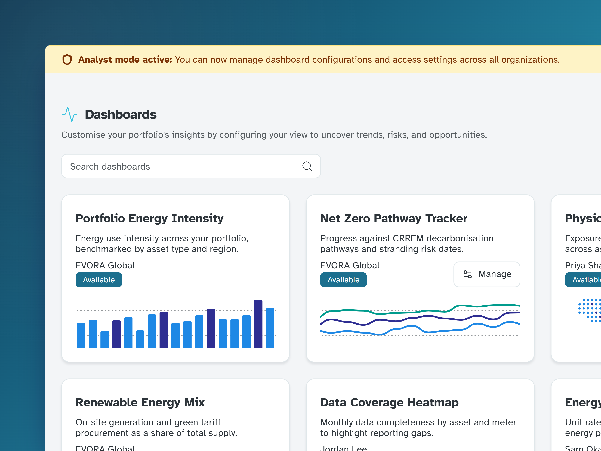
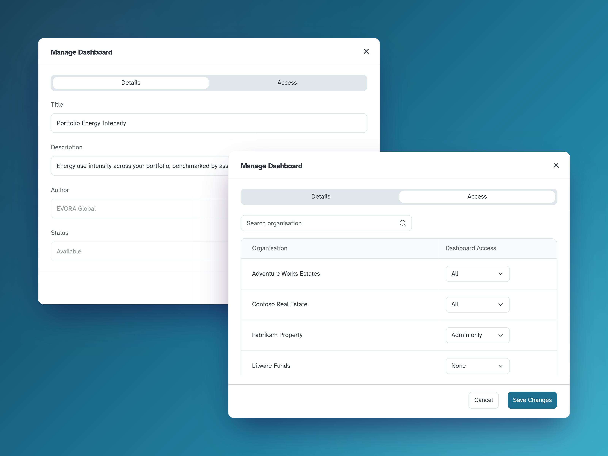
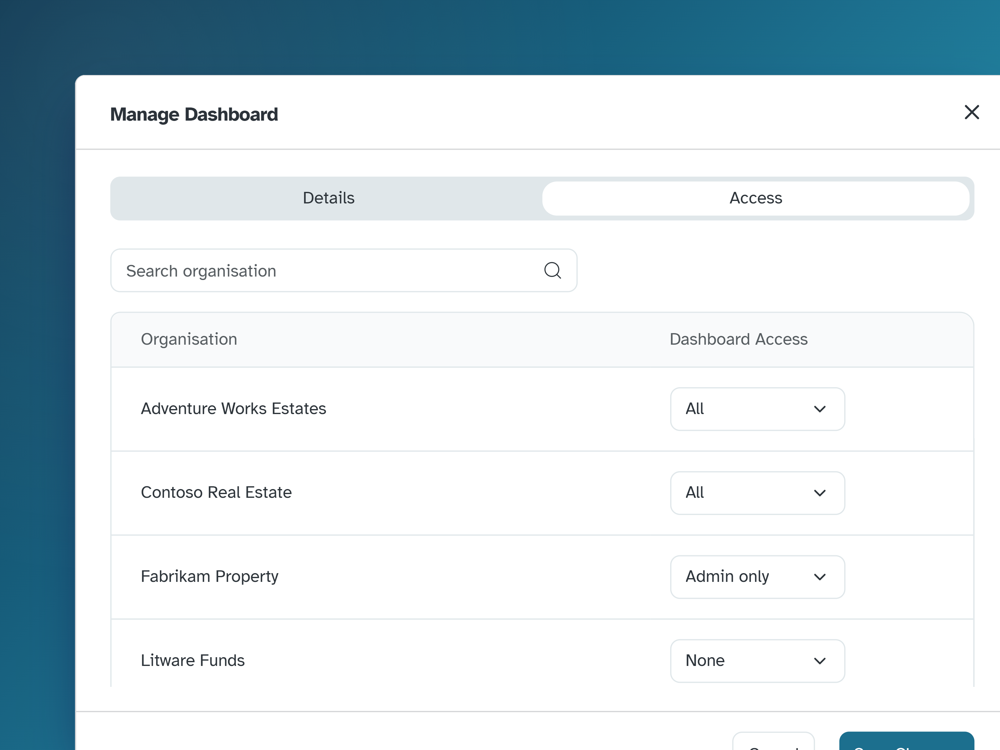
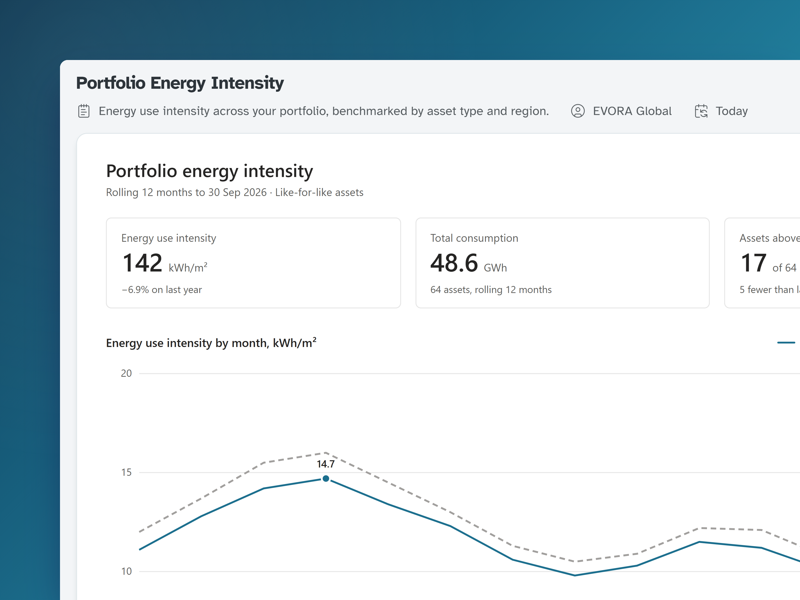

## Context

The first Analysis area was a set of native React charts, parts of which I designed and built. Every new chart had to be designed, built and released, so clients could only get answers as fast as our roadmap allowed, while Evora's analysts could build the same views in Power BI far faster.

## The decision

Most of the value in Analysis came from Evora's analysts and their ESG expertise rather than from the charts themselves, and Power BI was already better at charting than anything we would build. We migrated every hand-built chart to Power BI, retired the React versions and turned Analysis into Dashboards, the place where analysts publish their work to clients. Analysts look after the insight, and the platform looks after who can see it and whether they can trust it.

Embedding a Power BI report is straightforward. Most of the work went into making sure each person sees only the dashboards meant for them, filtered to their own organisation's data. We had three requirements:

- **Speed:** publishing a new dashboard shouldn't need a release.
- **Scale:** a single dashboard should serve every client, rather than a copy for each.
- **Control:** analysts should be able to manage access across all clients themselves.

## Two audiences, one interface

Clients see a searchable gallery of the dashboards their organisation has access to. Analysts use the same gallery with an **analyst mode** toggle switched on. We chose this over building a separate admin tool, so analysts publish from the same view the client will see, and we only have one interface to design, build and support.

**Make elevated power impossible to miss.** Analysts work inside the client's view, so the risk is forgetting they hold admin powers. A persistent amber banner fixes that without a confirmation dialog on every action.

## From Power BI to the client

Analysts build their reports in Power BI and upload them to a shared Power BI workspace. Each report in the workspace appears in the gallery as a draft, which only analysts can see in analyst mode. The analyst responsible then publishes it to one or more organisations and chooses who in each one can see it.

Power BIAn analyst builds a report and uploads it to the shared workspace

→

DraftIt appears in the gallery, visible only in analyst mode

→

PublishedAllAdmin onlyNoneAccess set for each organisation

<video class="bleed" src="/projects/analysis-dashboards/dashboards-publish-flow.webm" aria-label="An analyst switches on analyst mode: an amber banner appears, the organisation switcher blanks, and a draft and a missing dashboard join the gallery. They open Manage on the Energy Cost Volatility draft and publish it, then open Manage again, search the Access tab for Northwind Demo and set it to All. Switching analyst mode off returns to Northwind Demo's gallery, where the new dashboard now appears" controls autoplay muted loop playsinline preload="metadata"></video>

If someone deletes a report from the workspace, its dashboard is flagged as Missing in analyst mode, with a button to remove it from the gallery.

Each organisation can be given access for all users, admins only or nobody. The admins-only level means a new dashboard can be tried out with a client's admins before the rest of their team sees it.

We also moved access to the Dashboards area itself from front-end feature flags to **back-end entitlements**. Previously the UI hid the area from clients who didn't have it. Now the server checks on every request, so the business can grant it to each client knowing it's actually enforced.

## One dashboard, every client

The simpler option would have been a copy of each dashboard for every client, but then every fix has to be repeated in each copy, and each copy is another chance to show one client someone else's data.

Instead, I worked with the back-end engineers on **row-level security** based on the signed-in user, and made the API changes alongside the front end. Analysts build a dashboard once, each client only sees their own data in it, and a new dashboard is available to each organisation it's published to straight away.

One dashboardPortfolio Energy IntensityBuilt once in Power BI

→

Row-level securityFilters the data by the signed-in user's organisation

→

Each organisationNorthwind DemoContoso Real EstateFabrikam PropertySees only its own assets

## Outcome

  
<strong>0</strong>releases needed to get a new dashboard in front of clients

  
<strong>1</strong>version of each dashboard serves every client, each seeing only their own data

  
<strong>2</strong>audiences, clients and analysts, working in the same gallery

  
<strong>3</strong>access levels for each client, including an admins-only preview

Analysts can now get new analysis in front of clients without waiting for a slot on the engineering roadmap, and the team no longer maintains around 6,900 lines of bespoke chart code.

**Trade-off:** Power BI doesn't use our design system, so the charts inside the embed don't fully match the rest of the platform. We accepted that because it let analysts answer clients' questions far faster, and kept everything around the embed on-system.
