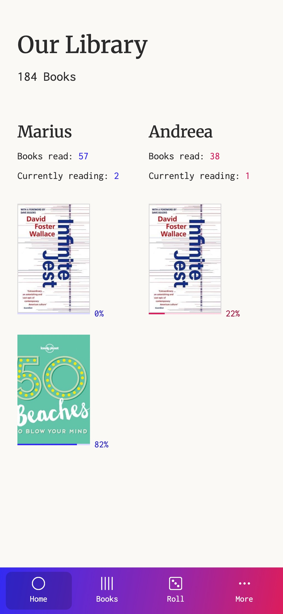
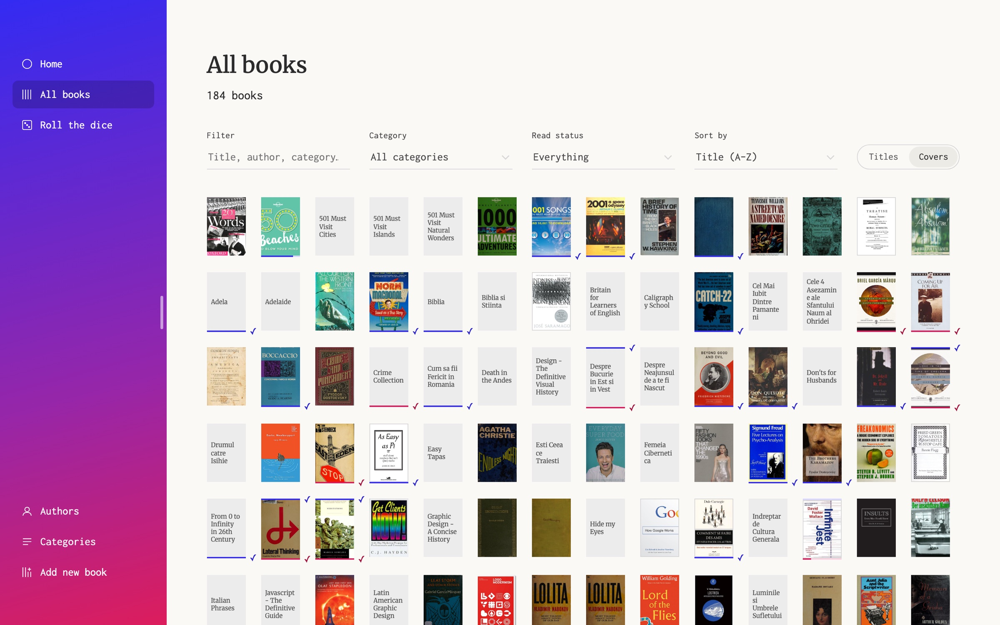
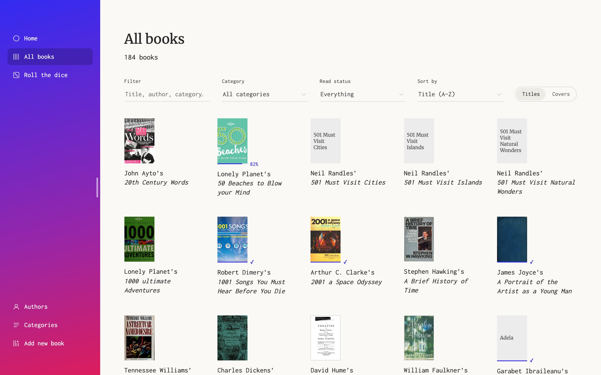
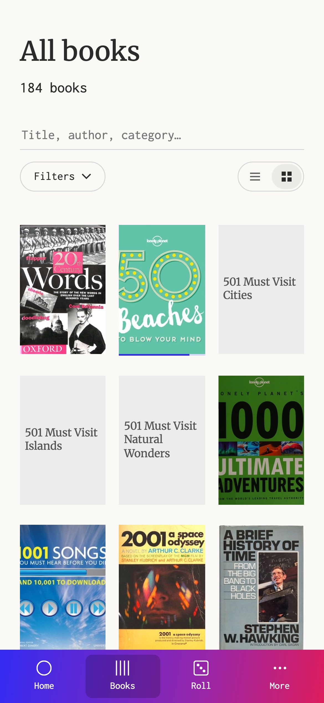
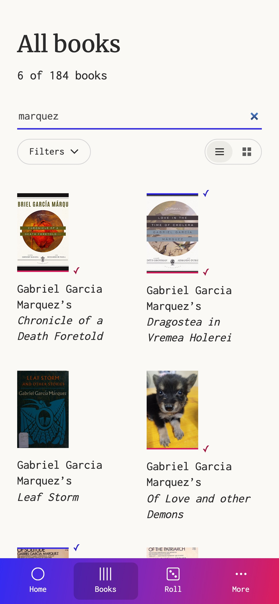
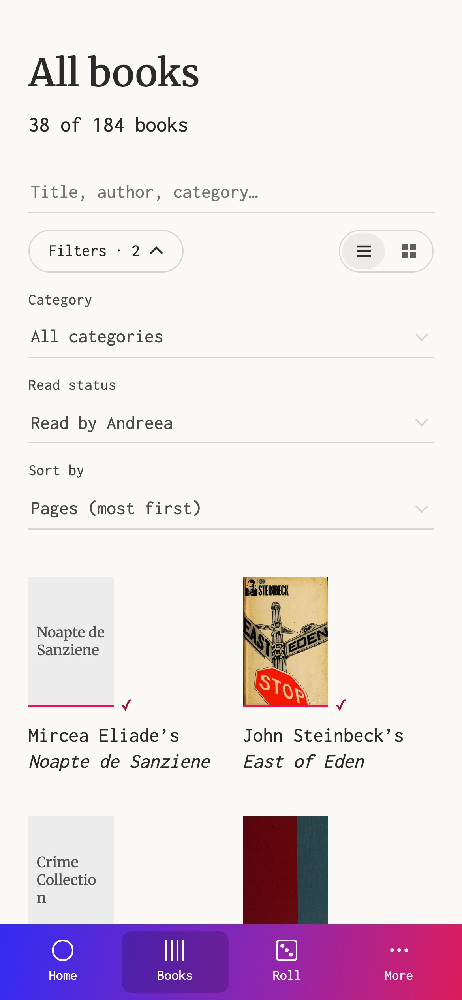
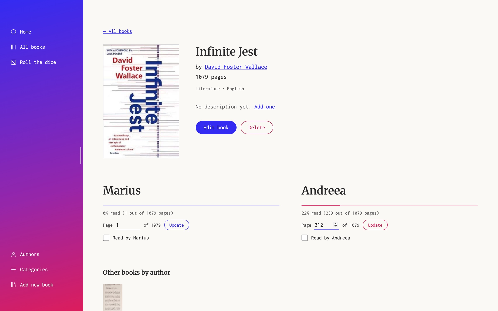
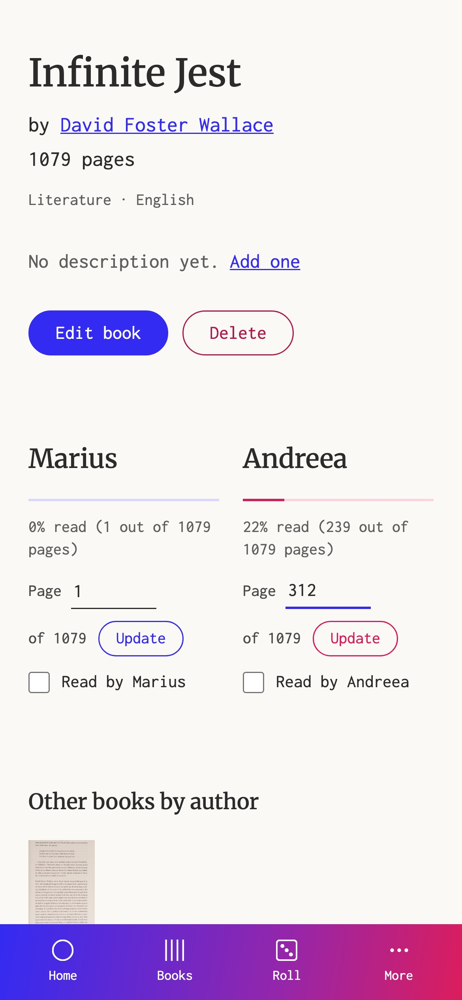
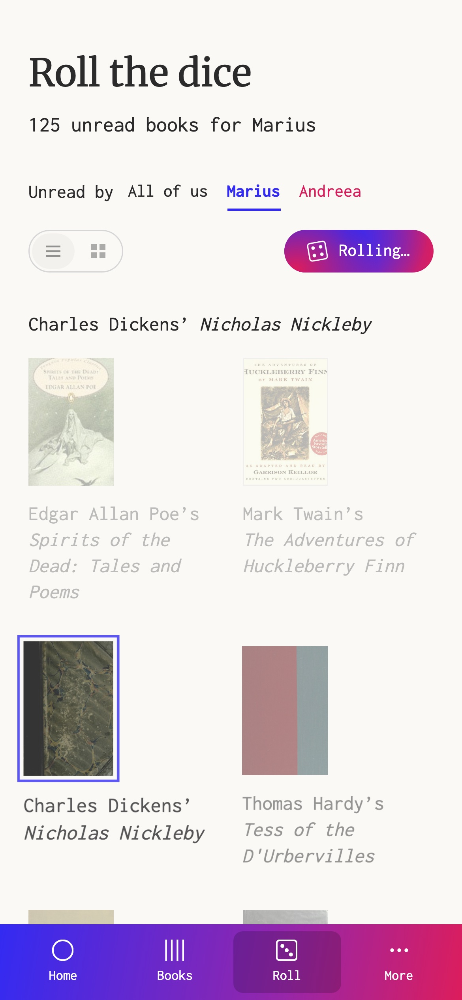
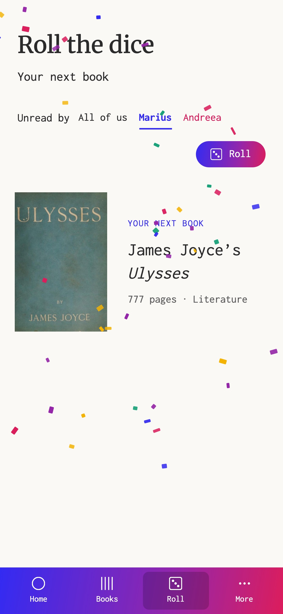

## Context

Our home library had outgrown its spreadsheet: no covers, no quick "have either of us read this?", and no help with *what should I read next?* I built a replacement, used it every day, redesigned it and then rebuilt it around the redesign.

  
<strong>184</strong>books, imported from the original spreadsheet

  
<strong>142</strong>authors across 8 categories

  
<strong>2</strong>readers, each with their own log

## The first version

The first version was full-stack: React, Node and Express, MongoDB, on Heroku, styled with Bootstrap.

- **A sortable, searchable catalogue,** with a "read" column for each reader and a running total.
- **Managed categories,** so a typo doesn't create a new genre.
- **Covers moved to FTP storage** on deployment, because Heroku doesn't keep files between restarts.

**Make choosing fun, not just fast.** Filters help when you know what you want; often you don't. "Pick my next book" spins a slot machine through the catalogue and lands on one book.

Using it daily showed its limits. "Read" was a yes or no, so the app couldn't tell what either of us was reading at the moment, and a ten-column table only worked on a wide screen.

## Redesigning it

After using the Bootstrap version daily, I redesigned it in Adobe XD:

- **A homepage per reader,** with books read and current reads with progress bars, instead of a table.
- **A slim side navigation** with the four things we do: search, view all, pick a random book, add a book.
- **Covers first,** for recognition titles can't give.

*The homepage as designed in Adobe XD, 2021.*

## Building the redesign

I rebuilt the app around the XD design, keeping it small: a Node server with no dependencies, the catalogue stored as JSON files, and 184 books imported from the original spreadsheet. Page counts replace the yes or no, so the homepage can show what each of us is reading and how far in.

Building it added three details the XD file didn't have:

- **Logging a page where you see it.** Each current read has a page field and an Update button, so updating progress takes one step from the homepage.
- **One colour per reader, everywhere.** The XD file gave each reader a colour on the homepage. The build carries blue and pink onto the read ticks, progress bars and buttons of every screen, so a glance says whose progress it is.
- **A menu you can fold away.** Dragging or clicking the menu's edge narrows it to its icons, giving the catalogue more room.

## Finding a book

All books is a grid of covers and titles, with a covers-only wall for when you're browsing by eye. Each cover carries a tick or a progress bar in each reader's colour.

*The covers-only wall. Hover to switch to covers with titles.*

One field filters by title, author, category or language as you type. The dropdowns cover the questions we actually ask: what has one of us read, what is one of us reading, and what has neither of us opened.

**Fold the filters on a phone.** Three dropdowns would push the books below the fold, so on a phone they sit behind a Filters button whose label counts the ones in use, such as "Filters · 2".

## A book and its readers

A book's page shows the cover, author and pages, then a section per reader: their progress bar, the page they're on and a "Read by" checkbox. The author's name opens all their books, and "Other books by author" lists the rest under the readers.

## Roll the dice

The slot machine from the first version became **Roll the dice**. You choose whose unread pile to roll through: either reader's or books neither of us has read. A spotlight hops across the covers and slows down before it lands. The winner gets a burst of confetti and a link to its page.

<video src="/projects/arnautus-library/home-library-desktop-flow.webm" aria-label="On a laptop, All books shows the titled grid beside the side navigation. Dragging the menu's edge folds it down to its icons, and switching to Covers fills the screen with a wall of covers. On Roll the dice, choosing Marius and rolling sends a spotlight hopping across about sixty of his unread covers, slowing until it lands on Tennessee Williams' A Street Car Named Desire and other Plays, with confetti. A click on the menu's edge opens it again, and All books returns to the titled grid" controls autoplay muted loop playsinline preload="metadata"></video>

<video src="/projects/arnautus-library/home-library-desktop-flow-dark.webm" aria-label="On a laptop, All books shows the titled grid beside the side navigation. Dragging the menu's edge folds it down to its icons, and switching to Covers fills the screen with a wall of covers. On Roll the dice, choosing Marius and rolling sends a spotlight hopping across about sixty of his unread covers, slowing until it lands on Tennessee Williams' A Street Car Named Desire and other Plays, with confetti. A click on the menu's edge opens it again, and All books returns to the titled grid" controls autoplay muted loop playsinline preload="metadata"></video>

The animation honours reduced-motion settings: the roll skips straight to the winner.

## On a phone

On a phone the side navigation becomes a tab bar for Home, Books and Roll. The less frequent pages (Authors, Categories and Add new book) sit in a More menu above it. The homepage shows each reader's current books as covers with progress bars, and the page-logging fields move to the book's own page.

<video class="phone-video" src="/projects/arnautus-library/home-library-phone-flow.webm" aria-label="On a phone, the homepage shows each reader's current books. Tapping Books opens the titled grid, which scrolls and then switches to the covers-only wall. Tapping Roll, choosing Marius and rolling sends a spotlight hopping across his unread covers until it lands on The Adventures of Huckleberry Finn, with confetti. The More menu opens above the tab bar, Authors lists every author, and Home returns to the start" controls autoplay muted loop playsinline preload="metadata"></video>

<video class="phone-video" src="/projects/arnautus-library/home-library-phone-flow-dark.webm" aria-label="On a phone, the homepage shows each reader's current books. Tapping Books opens the titled grid, which scrolls and then switches to the covers-only wall. Tapping Roll, choosing Marius and rolling sends a spotlight hopping across his unread covers until it lands on The Adventures of Huckleberry Finn, with confetti. The More menu opens above the tab bar, Authors lists every author, and Home returns to the start" controls autoplay muted loop playsinline preload="metadata"></video>

## Outcome

The rebuild carried over all 184 books and both reading histories, 57 and 38 books, from the original spreadsheet. It runs as one small Node server with no dependencies and no database, so keeping it running no longer depends on Heroku, MongoDB or FTP storage.

## What I learned

Shipping it plain first showed me what the homepage should be better than up-front design would have. The table answered "have we read this?", but daily use showed the question was "what are we each reading, and how far in?", and the redesign is built around that.
