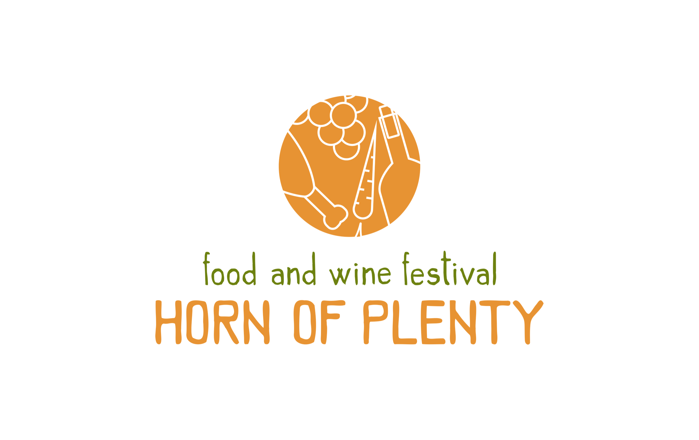
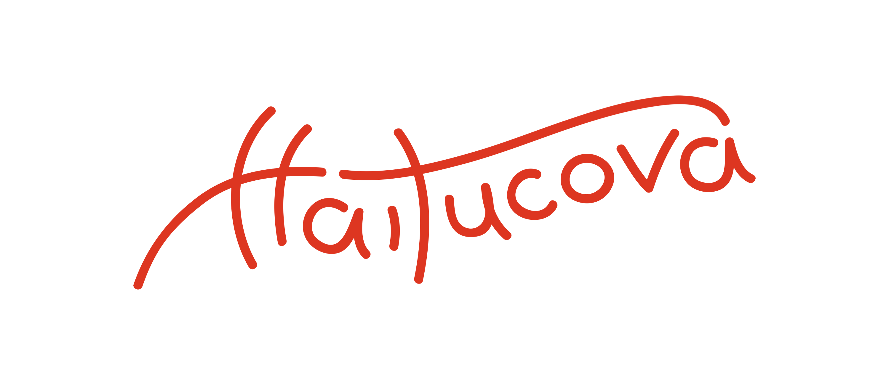
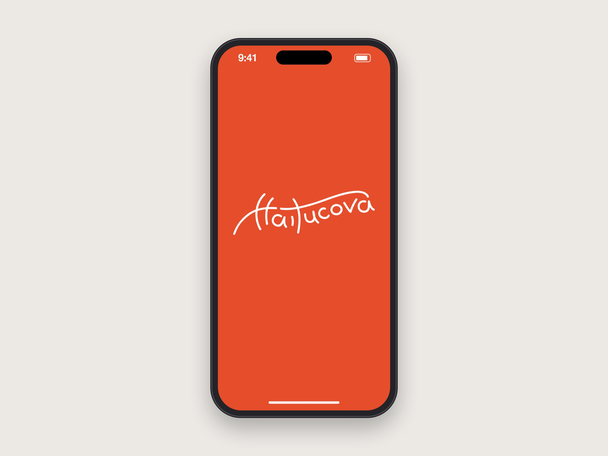
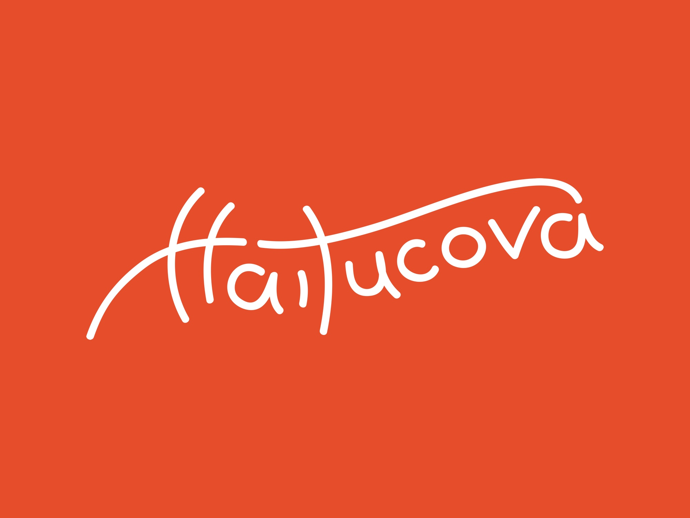
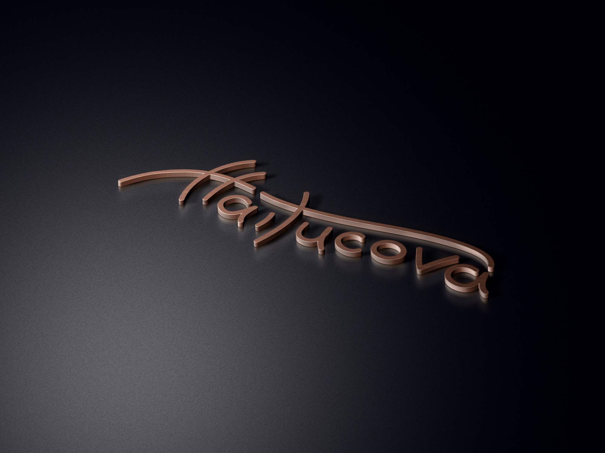

## Context

I've designed identities for small businesses, start-ups and cultural projects since 2012. This post collects them:

- **Horn of Plenty**, a festival identity with a custom typeface
- **Haitucova**, a hand-lettered wordmark
- **Selected identities**, a sheet of logos from 2012 on

## Horn of Plenty: a mountain food and wine festival

*2019 · Brand designer. I created the identity, the custom typeface and every application shown here.*

A three-day food and wine festival in Breb, a Maramureș village known for its wooden gates and crafts. The identity is rooted in the place and its produce, not generic festival branding.

The mark is a cornucopia in a single line and one colour, so it can be printed, stamped, embroidered or burned into wood without redrawing.

  

    <button type="button" class="keyboard__key" data-key="q" aria-label="q" style="--glyph: url(/projects/branding/horn-of-plenty/keys/q.png)"></button>
    <button type="button" class="keyboard__key" data-key="w" aria-label="w" style="--glyph: url(/projects/branding/horn-of-plenty/keys/w.png)"></button>
    <button type="button" class="keyboard__key" data-key="e" aria-label="e" style="--glyph: url(/projects/branding/horn-of-plenty/keys/e.png)"></button>
    <button type="button" class="keyboard__key" data-key="r" aria-label="r" style="--glyph: url(/projects/branding/horn-of-plenty/keys/r.png)"></button>
    <button type="button" class="keyboard__key" data-key="t" aria-label="t" style="--glyph: url(/projects/branding/horn-of-plenty/keys/t.png)"></button>
    <button type="button" class="keyboard__key" data-key="y" aria-label="y" style="--glyph: url(/projects/branding/horn-of-plenty/keys/y.png)"></button>
    <button type="button" class="keyboard__key" data-key="u" aria-label="u" style="--glyph: url(/projects/branding/horn-of-plenty/keys/u.png)"></button>
    <button type="button" class="keyboard__key" data-key="i" aria-label="i" style="--glyph: url(/projects/branding/horn-of-plenty/keys/i.png)"></button>
    <button type="button" class="keyboard__key" data-key="o" aria-label="o" style="--glyph: url(/projects/branding/horn-of-plenty/keys/o.png)"></button>
    <button type="button" class="keyboard__key" data-key="p" aria-label="p" style="--glyph: url(/projects/branding/horn-of-plenty/keys/p.png)"></button>
  

  

    <button type="button" class="keyboard__key" data-key="a" aria-label="a" style="--glyph: url(/projects/branding/horn-of-plenty/keys/a.png)"></button>
    <button type="button" class="keyboard__key" data-key="s" aria-label="s" style="--glyph: url(/projects/branding/horn-of-plenty/keys/s.png)"></button>
    <button type="button" class="keyboard__key" data-key="d" aria-label="d" style="--glyph: url(/projects/branding/horn-of-plenty/keys/d.png)"></button>
    <button type="button" class="keyboard__key" data-key="f" aria-label="f" style="--glyph: url(/projects/branding/horn-of-plenty/keys/f.png)"></button>
    <button type="button" class="keyboard__key" data-key="g" aria-label="g" style="--glyph: url(/projects/branding/horn-of-plenty/keys/g.png)"></button>
    <button type="button" class="keyboard__key" data-key="h" aria-label="h" style="--glyph: url(/projects/branding/horn-of-plenty/keys/h.png)"></button>
    <button type="button" class="keyboard__key" data-key="j" aria-label="j" style="--glyph: url(/projects/branding/horn-of-plenty/keys/j.png)"></button>
    <button type="button" class="keyboard__key" data-key="k" aria-label="k" style="--glyph: url(/projects/branding/horn-of-plenty/keys/k.png)"></button>
    <button type="button" class="keyboard__key" data-key="l" aria-label="l" style="--glyph: url(/projects/branding/horn-of-plenty/keys/l.png)"></button>
  

  

    <button type="button" class="keyboard__key" data-key="z" aria-label="z" style="--glyph: url(/projects/branding/horn-of-plenty/keys/z.png)"></button>
    <button type="button" class="keyboard__key" data-key="x" aria-label="x" style="--glyph: url(/projects/branding/horn-of-plenty/keys/x.png)"></button>
    <button type="button" class="keyboard__key" data-key="c" aria-label="c" style="--glyph: url(/projects/branding/horn-of-plenty/keys/c.png)"></button>
    <button type="button" class="keyboard__key" data-key="v" aria-label="v" style="--glyph: url(/projects/branding/horn-of-plenty/keys/v.png)"></button>
    <button type="button" class="keyboard__key" data-key="b" aria-label="b" style="--glyph: url(/projects/branding/horn-of-plenty/keys/b.png)"></button>
    <button type="button" class="keyboard__key" data-key="n" aria-label="n" style="--glyph: url(/projects/branding/horn-of-plenty/keys/n.png)"></button>
    <button type="button" class="keyboard__key" data-key="m" aria-label="m" style="--glyph: url(/projects/branding/horn-of-plenty/keys/m.png)"></button>
  

A custom alphabet, like lettering on a hand-painted village sign, and a harvest palette: pumpkin, vine green and old-wood brown on a cream ground.

<ul class="swatches" aria-label="The Horn of Plenty palette">
  <li class="swatches__item">Pumpkin</li>
  <li class="swatches__item">Vine green</li>
  <li class="swatches__item">Old-wood brown</li>
  <li class="swatches__item">Cream</li>
</ul>

**Draw the type rather than license it.** An off-the-shelf "rustic" font would look like any farmers' market. A custom alphabet gave the festival its own voice and matches the line drawings.

## Haitucova: a hand-lettered wordmark

*2013 · Brand designer. I lettered the wordmark and drew it up as a vector.*

One long stroke rises through the **H**, crosses the **t** and arcs over the rest of the word, so the name reads as a single gesture.

## Selected identities

*2012 – present · Brand designer.*

<ul class="logo-wall" aria-label="25 logos">
  <li class="logo-wall__item"></li>
  <li class="logo-wall__item"></li>
  <li class="logo-wall__item"></li>
  <li class="logo-wall__item"></li>
  <li class="logo-wall__item"></li>
  <li class="logo-wall__item"></li>
  <li class="logo-wall__item"></li>
  <li class="logo-wall__item"></li>
  <li class="logo-wall__item"></li>
  <li class="logo-wall__item"></li>
  <li class="logo-wall__item"></li>
  <li class="logo-wall__item"></li>
  <li class="logo-wall__item"></li>
  <li class="logo-wall__item"></li>
  <li class="logo-wall__item"></li>
  <li class="logo-wall__item"></li>
  <li class="logo-wall__item"></li>
  <li class="logo-wall__item"></li>
  <li class="logo-wall__item"></li>
  <li class="logo-wall__item"></li>
  <li class="logo-wall__item"></li>
  <li class="logo-wall__item"></li>
  <li class="logo-wall__item"></li>
  <li class="logo-wall__item"></li>
  <li class="logo-wall__item"></li>
</ul>

## What I learned

Every mark here had to survive everywhere it went. The Horn of Plenty cornucopia had to print, stamp, embroider and burn into wood without redrawing, and each logo had to read as clearly on a phone screen as on a sign. That meant finding the one idea that carries a brand and cutting everything else. It's how I still work, on brands and products alike.
