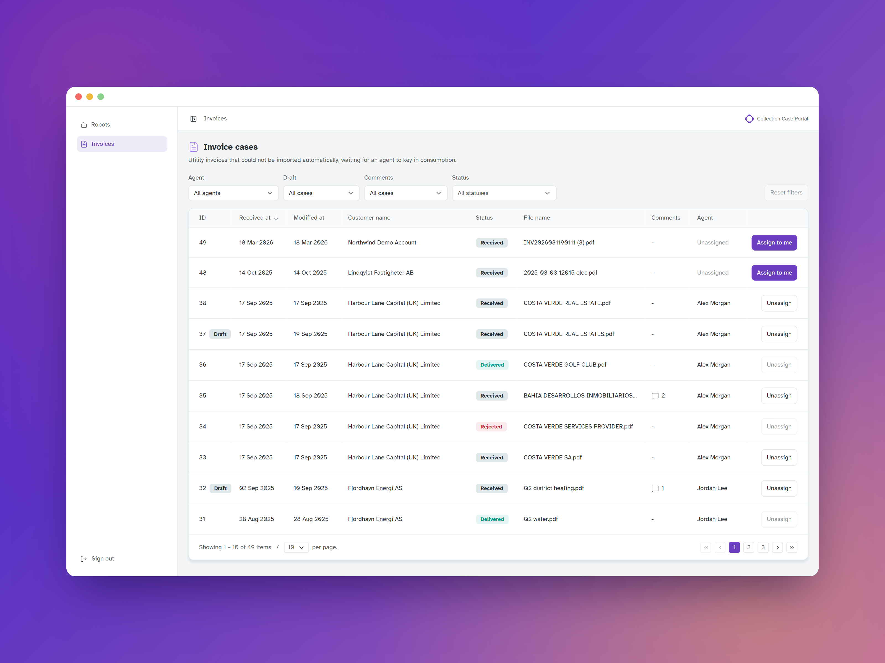
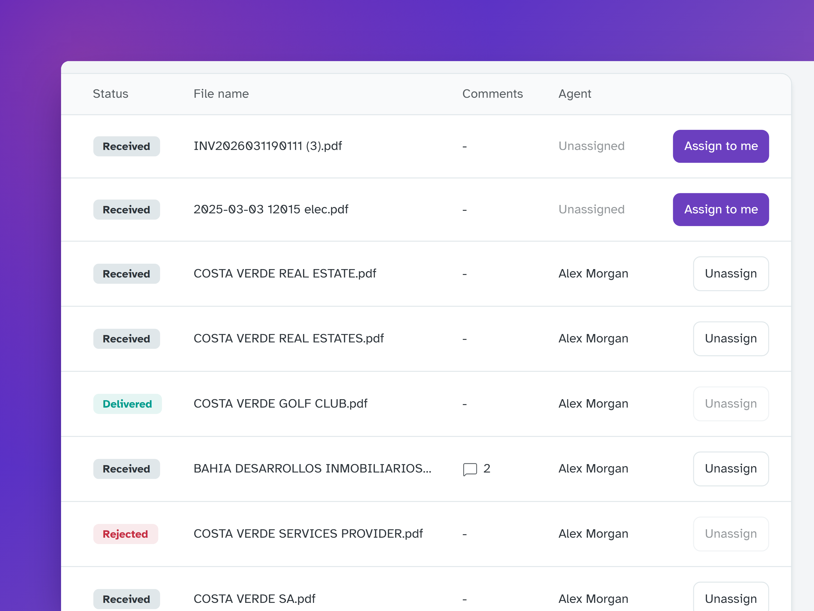
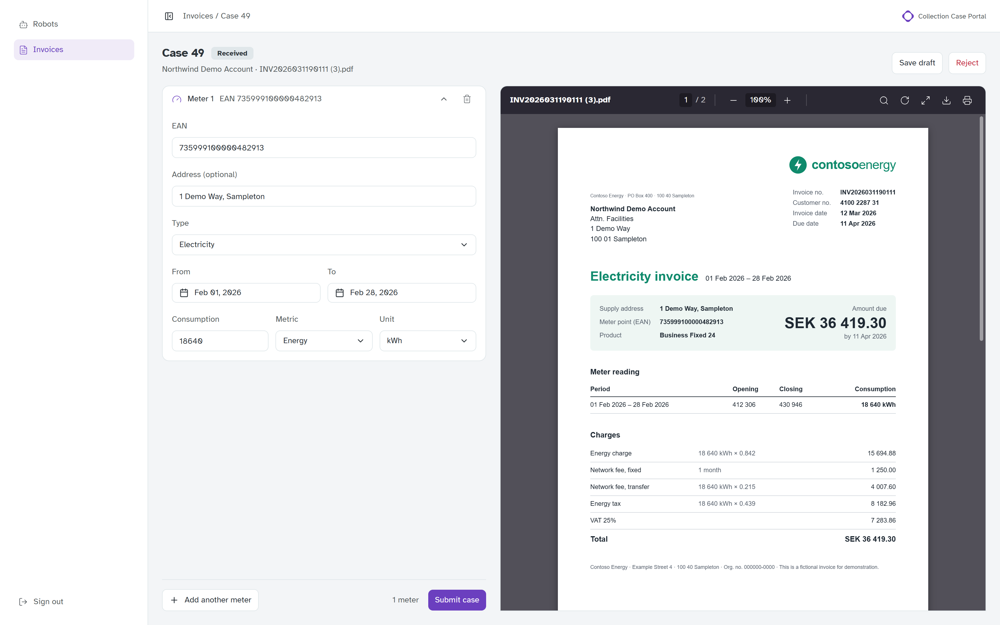
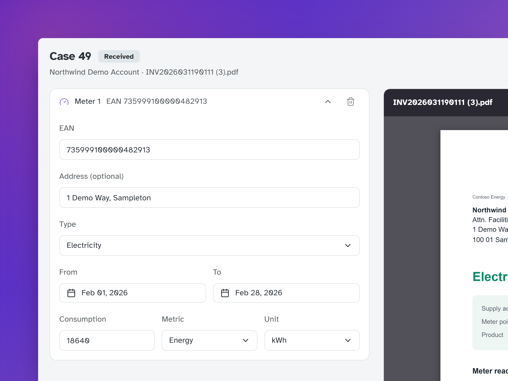

## Context

When a utility's automated feed fails, an operations agent keys in consumption from the invoice by hand, and those readings go straight into clients' carbon reports. At Metry I designed and built the **invoice cases** in the Collection Case Portal: the queue, the case detail and the rules connecting them.

Evora acquired Metry at the start of 2024, and I worked with the team in Gothenburg, Sweden, to extend their existing Collection Case Portal. Until then, readings came in only through robots and scrapers; this work added manual invoice parsing for when they fall short. Part of it was re-building the app on Evora's [design system](/projects/design-system/).

## The problem(s)

- **Volume:** every extra click is multiplied.
- **Messy inputs:** long EAN meter codes, easy to mistype, sometimes unknown.
- **Some cases can't be completed**, but the record must stay.
- **Shared queues:** ownership must be obvious.

## What I built

### A queue that supports triage

Filters for several statuses at once and for **unassigned cases**, so team leads spot work falling through the cracks.

<video class="bleed" src="/projects/collection-case-portal/invoice-list-assign.webm" aria-label="An agent clicks Assign to me on an unassigned case, and their name replaces Unassigned in the row" controls autoplay muted loop playsinline preload="metadata"></video>

**Keep the queue's state when the agent goes back.** Agents return to the list dozens of times a day; keeping filters and page saves rebuilding it every time.

### A case detail that prevents bad data

- Specific errors for unknown EANs, and creating a new meter from inside the case instead of escalating.
- Several meters per invoice, and drafts.
- Reversible rejection that locks the case's fields.

<video class="bleed" src="/projects/collection-case-portal/ccp-case-flow.webm" aria-label="An agent opens a draft case from the queue, scrolls the invoice to the meter reading, keys the consumption into the form and submits the case" controls autoplay muted loop playsinline preload="metadata"></video>

### From failure to case automatically

In the admin tool, a failed automated import can become an invoice case directly, with its context, instead of an email. I added unit tests around the API calls, because a silent failure means a client's report quietly misses a month.

<!-- TODO (Marius): outcome, e.g. cases processed per week, time per case, reduction in escalations to engineering, feedback from the operations team. -->

The best UX in an operations tool is usually invisible: state that survives navigation, errors that say what to do next, and actions that can be undone.
