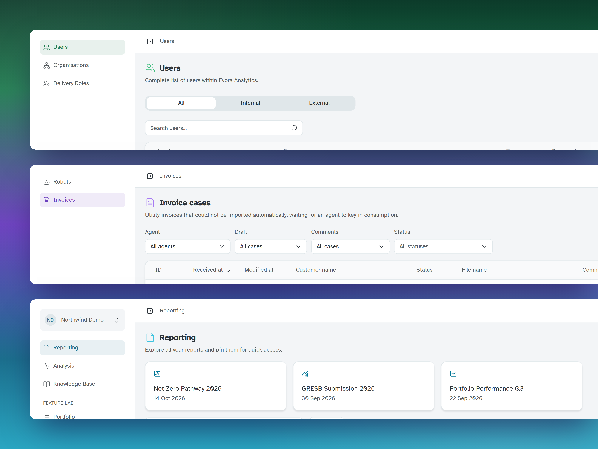

## Context

The new platform started with a local UI kit inside the main app. When an internal admin console arrived, components began to be copied between repos and drift, so the same action could look and behave differently from one app to the next. I turned the kit into a versioned, documented package that every app installs.

<video class="bleed" src="/projects/design-system/ds-reel.webm" aria-label="The library's components rise into place in a wave across the grid. The camera closes in on the data table, where every row is selected and sorted by EPC rating, then steps through the stepper and publishes a report with a success toast" controls autoplay muted loop playsinline preload="metadata"></video>

## Move components out, then import them

I moved components out in small, reviewable steps, keeping existing APIs where possible so the app could switch one import at a time.

**Add a component once a second app needs it.** Anything tied to one product, such as the CCP's invoice form, stays in that app, so the library stays small and general.

## Tokens for the domain

I set up the tokens as Figma variables for colour, spacing and sizing, in two layers:

- **Primitives:** the raw values, such as Evora's palette ramps.
- **Semantic tokens:** what each value is for, such as background, border or destructive. Components use these, and each one has a **light** and a **dark** mode, with text contrast checked against WCAG AA in both.

In code they become CSS variables, exposed through a Tailwind preset.

Primitiveslight-blue-100neutral-100error-100space-8space-16radius-8

→

Semanticbackgroundborderdestructivepadding-inputgap-sectionradiusColours in light and dark

→

ComponentsButtonInputData table

## Figma and code match

The Figma library mirrors the code: the same component names, the same structure and the same tokens. What a designer draws is what a developer imports.

## Small pieces, bigger components

Simple components such as checkboxes, buttons and menus combine into larger ones. The **data table** is built from them, adding sticky columns, filters you can share as a link, and the same formatting in every app.

**Build on Radix primitives.** Keyboard support and focus management come from a well-tested base, so a small team could spend its time on domain-specific data components.

## Documentation

Every component is published to Storybook, so anyone in the company can see what already exists without opening the code. New features start from the same building blocks, and everyone calls them by the same names. Chromatic flags any visual change before it ships.

## Outcome

  
<strong>3</strong>apps built on it

  
<strong>45</strong>composable components

  
<strong>56</strong>releases in 12 months

  
<strong>8,375</strong>lines of UI moved out

The client platform, the admin console and the [Collection Case Portal (CCP)](/projects/collection-case-portal/) all run on it, so they behave like one product.

The admin console and the CCP had the library from day one. In the admin console, the first screen, a list of users, was built the day after the library was installed.

A design system pays off when it is the easiest way to build: if the right component already exists, nobody draws a new one.
