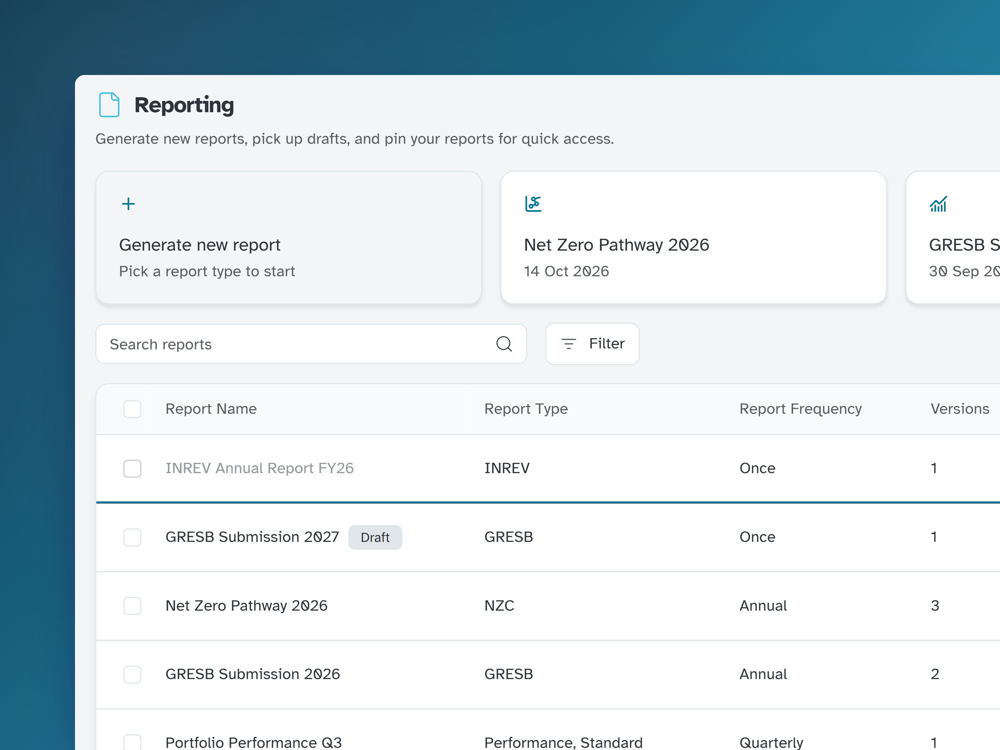
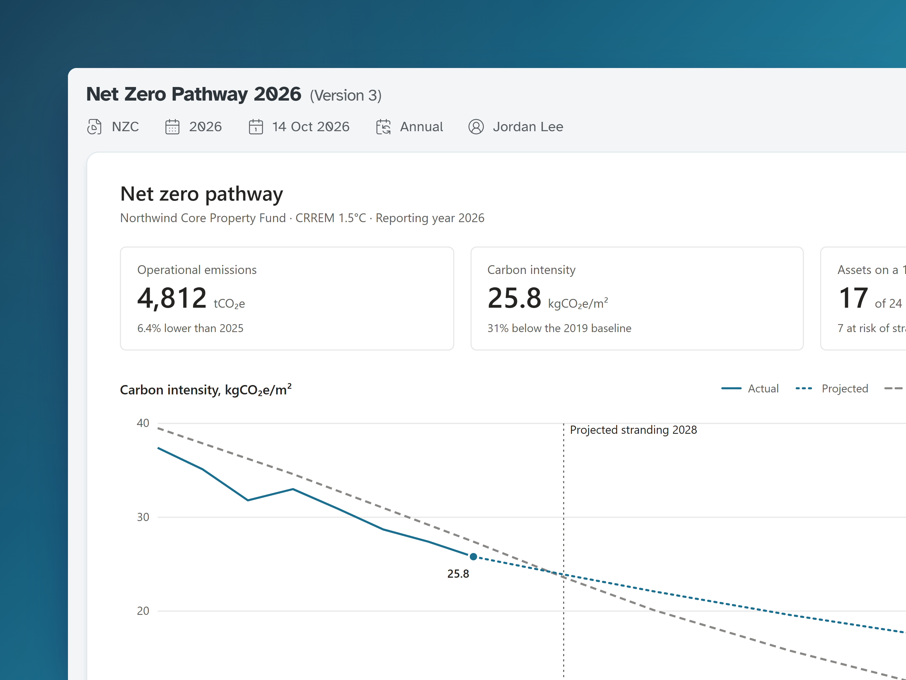
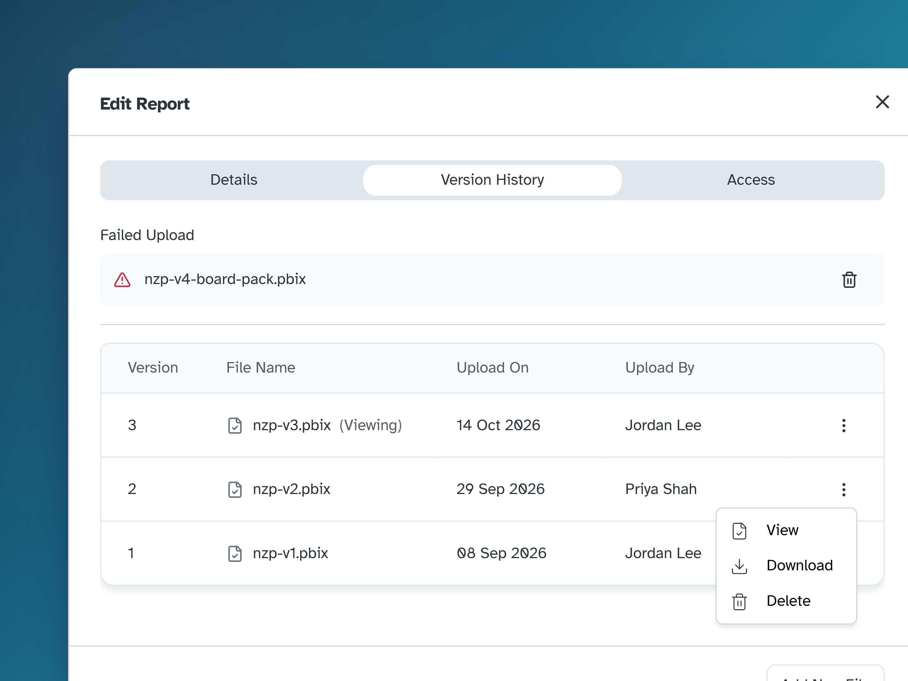
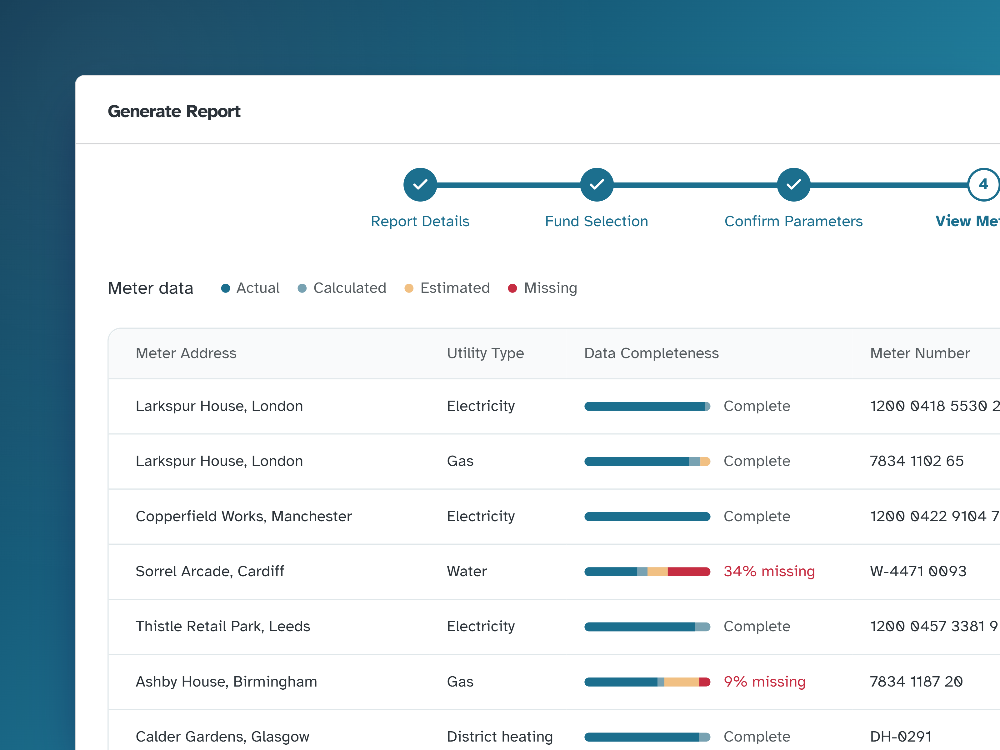

## Context

Evora's clients, real estate fund and asset managers, owe investors and regulators a stack of sustainability reports every year: GRESB, INREV, EPRA, GHG, net zero and bespoke packs. These used to arrive from consultants as PDFs and Power BI files in email threads. The platform needed one place to find, trust, share and eventually generate them.

I planned the research around how reports were produced, and our UX researcher ran the interviews. Our consultants spent around two weeks on each INREV report: most of it chasing missing meter readings, and about a day building the report itself.

## The problem

- **Volume:** 10 report types and five frequencies, from monthly to one-off.
- **Versions:** a GRESB submission goes through several drafts, and opening the wrong one in a board meeting is a real risk.
- **Access:** fund data can't leak between teams, yet consultants, asset managers and executives need different access to the same report.

Before, every draft travelled by email:

ConsultantBuilds the report from the client's data

→

EmailPDF or .pbix attached, one thread per draft

→

ClientSearches the inbox for the latest version

Now the client generates the report, and every version lives in one place:

ClientGenerates the report on the platform

→

Data qualitySees the gaps before it's produced

→

LibraryOne versioned report, shared by access

## Trust first, then self-serve

We shipped in two stages. The library and report pages came first, while consultants still produced the reports, so clients got used to the platform as the place their reports live. Generation came two months later, and only once the data quality step existed: letting clients produce reports was only safe if they could see the gaps first.

Self-serve changes what our consultants do, so they reviewed each step of the wizard. Their checklist for spotting bad data became step 4.

## Report library

Every report now lives in one library: a dense, sortable table with filters and search. Drafts are labelled, and a report that is still generating stays in the list with a progress bar under its row, so nobody has to wait on the page.

Above the table sit **Pinned reports**, next to the card for generating a new one. **Add report** uploads a file in three steps, with access set before it's saved, so a new report is never briefly visible to the wrong people.

**Cap pinned reports at three.** We started with no limit. Within 12 weeks, some users had pinned 10+ reports and stopped using the table, so pins had become a second, worse library. Pinning a fourth now shows a toast explaining why.

## Report page

Each report opens in the platform, not as a download: PDFs inline, and Power BI embedded with silent token refresh, so a report left open in a meeting doesn't expire. The version number sits next to the title, so it's clear which draft is on screen.

**Manage report** keeps everything else about the report in one dialog:

- **Version history**, showing which version is on screen, with failed uploads flagged as failed, not left spinning.
- **Access**: owner, editor, viewer or no access, plus a change-owner flow that doesn't need a support ticket.

## Guided report builder

Clients can now generate reports themselves, without waiting on a consultant. A long form is hard to focus on, so it's split into five steps, with the most important choices first. If something isn't to hand, the report can be saved as a draft at any step.

<video class="bleed" src="/projects/esg-reporting/reporting-generate-flow.webm" aria-label="A fund manager clicks Generate new report, picks INREV, names the report and selects the fund. On View Metrics the camera closes in on a water meter in Cardiff with 34% of its data missing. They confirm and generate the report, which appears at the top of the library with a progress bar filling under it, then a Report ready toast offers the download" controls autoplay muted loop playsinline preload="metadata"></video>

<ol class="flow">
  <li><strong>Report details</strong>Framework, period and name.</li>
  <li><strong>Fund selection</strong>One fund per report, stated up front.</li>
  <li><strong>Confirm parameters</strong>Assets and sector breakdown, so surprises surface before generation.</li>
  <li><strong>View metrics</strong>Data completeness per meter: actual, calculated, estimated and missing.</li>
  <li><strong>Summary tables</strong>A final review before the report is generated.</li>
</ol>

**Show data quality before the report, not inside it.** Missing or estimated data is the most common reason a report gets challenged. Step 4 shows it while the fund manager can still fix it, not when an investor asks. We considered blocking generation when data is missing, but some frameworks accept estimates, so the step shows the gaps and leaves the decision to the fund manager.

What usually isn't to hand is a missing meter reading. **Save & Close** lets the fund manager go and chase it, then pick up where they left off.

## Outcome

  
<strong>~1 day → 10 min</strong>to generate an INREV report, once the data is in

  
<strong>71</strong>reports generated by clients in the 10 months since launch

  
<strong>103</strong>client organisations on the library

The one-day figure comes from the consultants who built these reports the old way, and the rest from analytics built into the platform, over its first year.

Next: letting clients fix a missing reading from inside step 4, instead of leaving the wizard to chase it.
