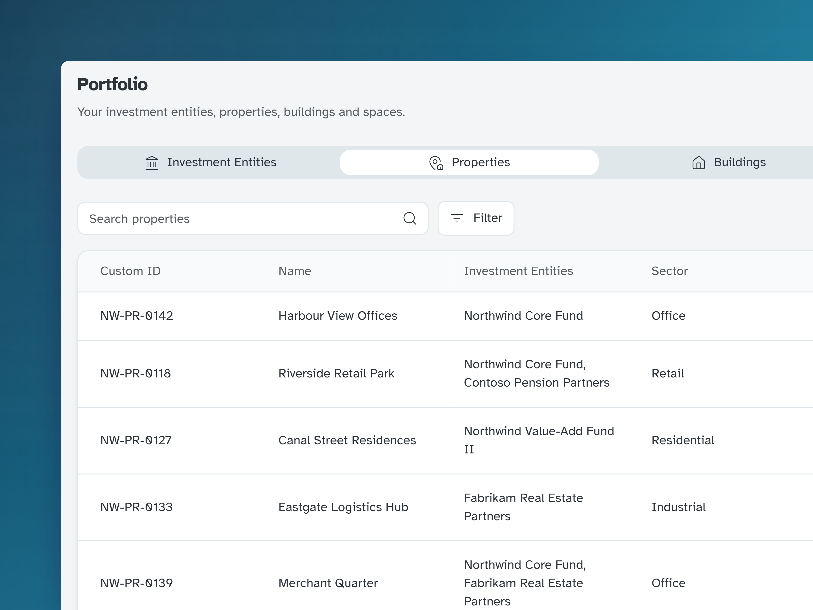
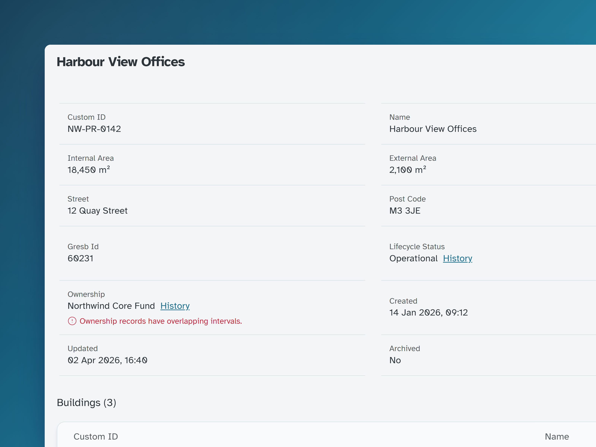
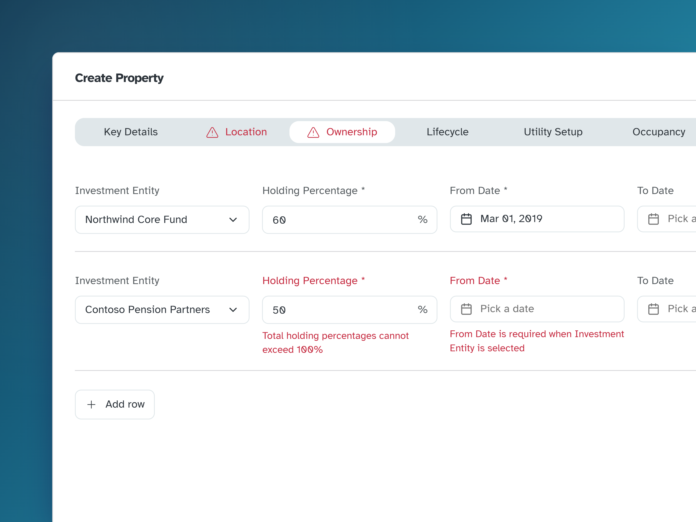

## Context

Every number in an ESG report rests on portfolio data: which buildings a fund owns, what share, how big they are and which utilities they use. If it's wrong, every carbon intensity and GRESB score is wrong too.

This data used to live in Excel spreadsheets, kept up to date by both Evora's consultants and its data team. There was no single source of truth, with several versions of the same spreadsheet in circulation and no reliable way to tell which one a report had been built from. The data that had already reached the database was poor too, because nothing checked it on the way in.

My job was to turn the new portfolio data model into something people could browse and keep up to date, with guardrails that stop bad data getting in and show where it already exists. My team's researchers ran interviews and usability tests along the way.

## The problem

The model has five entity types, each nested inside the one above it.

Investment entityNorthwind Core FundOwns a share of its properties for a set period

→

PropertyHarbour View OfficesCan be split between several entities

→

External spaceCar parkAn outdoor area that belongs to the property rather than a building

→

BuildingNorth WingTakes its property's sector unless you change it

→

Internal spaceFloor 3A floor or unit inside a building

- **Shared ownership:** a property can be split between funds, with percentages that change over time.
- **Time-varying facts:** ownership, lifecycle stage, occupancy and managing agents change, and reports need what was true in a given year.
- **Rare edits:** most people touch this data a few times a year, so the interface can't rely on memory.

## One table for each level of the pyramid

The model is a pyramid, but the research showed it couldn't work as one nested table. A portfolio holds far too many properties, buildings and spaces for a tree to stay usable. The compromise we settled on was a separate table for each entity type, each with its own search and pagination, and filters on all but the investment entities.

That puts more of the hierarchy on the user, who has to keep the pyramid in mind while moving between tables. So the tabs run in the pyramid's order, from investment entities down to spaces, and each detail page lists the level below it, so people can still work down the hierarchy one step at a time.

## One page pattern for five entity types

Every entity type uses the same detail page layout, from a fund down to an internal space.

**One pattern, configured per entity.** Users learn the page once. For the team, a new attribute is a config change rather than a new screen, which mattered while the data model was still evolving.

The page also shows problems the API finds in the stored data, on the row they're about. Each one is marked as an error, a warning or a note, so someone looking at a property can tell an overlapping ownership record, which will distort a report, from a missing managing agent, which only needs filling in.

## History where the value changes

<video class="bleed" src="/projects/portfolio/portfolio-history-flow.webm" aria-label="On the Harbour View Offices property page, the camera moves in on the Ownership row and its red error, Ownership records have overlapping intervals. Clicking History slides in the Ownership sheet, whose timeline lists Northwind Core Fund from 1 Jan 2024 to the present, Northwind Core Fund again from 1 Mar 2019 to 31 Mar 2024, and Contoso Pension Partners from 2012 to 2019. The two Northwind records are tinted red, showing they overlap in early 2024. The sheet closes and the page returns" controls autoplay muted loop playsinline preload="metadata"></video>

Ownership, lifecycle stage and managing agents all change over time, and reporting needs both the current state and the earlier ones, because a report for a past year has to use what was true then. The research made that clear, so the page shows the current value with a History link beside it. The link opens a timeline of every period, newest first, so the overlap behind the error above is easy to spot, with the fund's two records sharing the first three months of 2024. Records like these came in with the data that was already in the database, before any of the checks existed.

## Forms that catch problems early

Creating a property covers nine groups of information. I split them into **tabs with their own error indicators**, so after saving, a problem on Location is visible while you're still on Ownership. Ownership supports several owners, each with a GRESB asset ID, a share and the dates it applied. When a fund's share changes, its row gets an end date and a new row starts from the date of the change, so the same fund can appear more than once as long as its periods don't overlap.

Most people only edit this data a few times a year, so the form doesn't rely on them remembering how it works, and the tabs point straight to whatever needs fixing.

**Block what the form can see, flag the rest where people look.** The form stops shares that add up to more than 100%, or an owner without a start date, before anything is saved. Other rules need the stored data, such as ownership periods that overlap or buildings that add up to more than their property's area, so the API checks those and the detail page shows the result on the row it's about, using server rules I helped write.

## Outcome

Portfolio is live in Feature Lab, the part of the platform for new, experimental features. It's switched on for everyone at Evora and for a few selected clients, so consultants and the data team can work from one shared source rather than their own copies of a spreadsheet. As it rolls out further, the measures to watch are how many flagged problems get resolved and whether reports still need data from spreadsheets.

**Trade-off:** Splitting the pyramid into separate tables keeps a large portfolio manageable, but nobody can see the whole hierarchy at once any more. We accepted that because one nested view broke down at the size of a real portfolio, and the tab order and each detail page's table of children let people rebuild the shape one level at a time.