## Context

SIERA was Evora Global's ESG data platform for real estate investors, tracking energy, carbon and net zero targets across their funds and assets.

I joined in 2019 as a UX designer and developer, building its React data-visualisation module. From 2021, as Principal Designer, I led the design direction and set up Pendo and Hotjar to check decisions against real behaviour. I designed every feature shown here and built two of them, the asset dashboard and the net zero modelling. All of them shipped.

The screens below are rebuilt with sample data, so no client names or figures appear.

## The problem

A fund manager reporting on carbon is rarely working from complete data. Over a year, a single asset's figures are pieced together from several places:

- **Different sources:** meter readings, invoices, suppliers' own estimates, and estimates SIERA calculates to fill the gaps.
- **Landlord and tenant data:** the landlord controls some meters and tenants control others.
- **Different reference points:** a figure can be compared with a target, where one has been set, or with the previous period.

A total that hides any of this looks more certain than it is, and that matters once it reaches an investor report.

In earlier versions of SIERA, Pendo showed clients logging in, landing on the asset list and leaving. The versions in this case study set out to show what each number is made of wherever the number appears, starting from the first screen of an asset.

## Showing what each number is made of

The asset dashboard opens with one card per utility. Each bar is split into actual and gap-filled data, with the target or the previous period marked across it, so a figure that is mostly estimated looks different from one that is mostly measured.

Two small icons tell the reader which comparison they are looking at: a target for "variance against target" and a calendar for "variance against previous period". They mean the same thing on the dashboard, in the asset list and in chart tooltips, so a percentage never has to be read without its reference point.

**Keep data quality on the same screen as the number.** Coverage by floor area and data completeness sit on the dashboard itself, so nobody has to open the Data Quality tab to know whether a figure can be trusted.

## Finding the gaps

When the data isn't complete, the next question is where the gaps are. The Data Quality tab has a summary and a meter view. The meter view gives each meter a 12-month strip coloured by actual, supplier estimated, calculated estimate and missing, and labels it landlord or tenant, so a month that needs chasing stands out without reading a table.

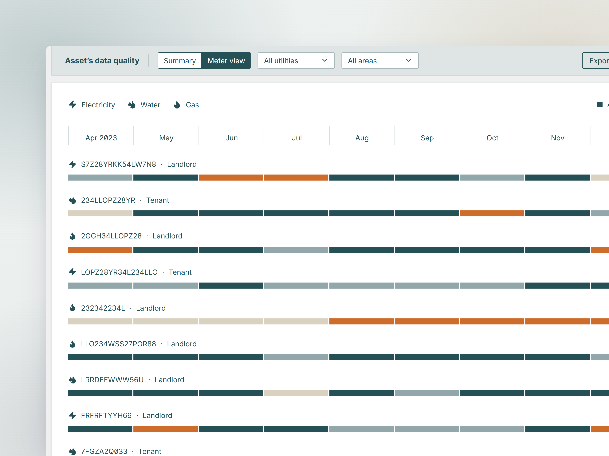

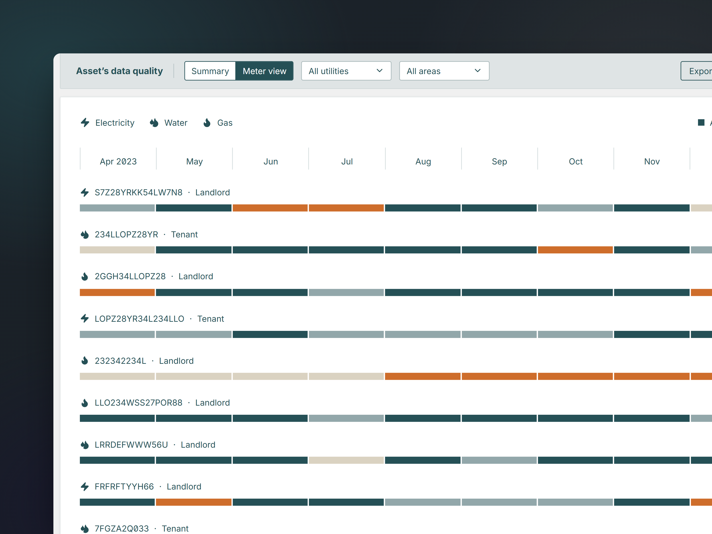

At fund level, the same tab ranks assets by their share of the fund's missing data and splits it into landlord and tenant data, so the team can start with the assets that make the biggest difference to the fund's figures.

The same principle later shaped the data quality step in [self-serve ESG reporting](/projects/esg-reporting/), where fund managers see the gaps before a report is generated.

## Explaining why a number moved

Once a variance stands out, the next question is why it happened. The Performance tab breaks consumption down by sector or by tenant, with gap-filling switched on or off, and a line above the chart says what the data is being compared with, such as a carbon target instead of the previous period.

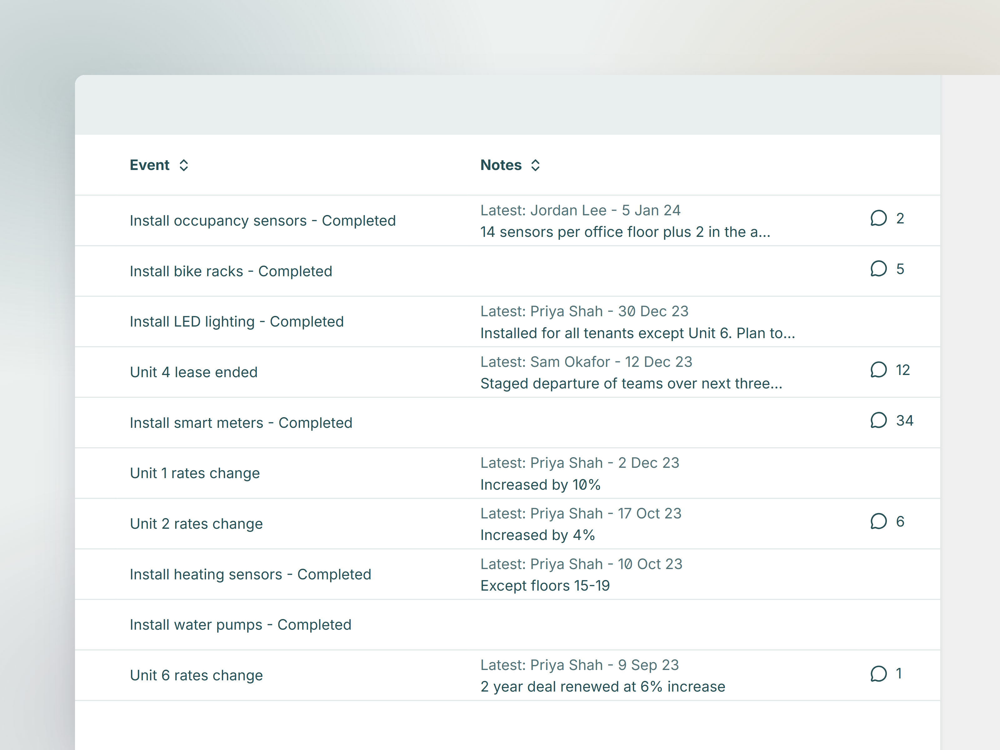

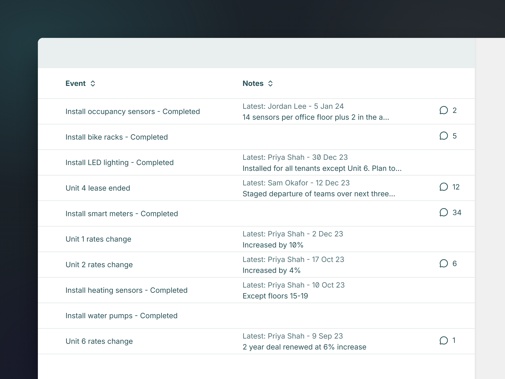

Under the chart, an **Events** table lists what happened at the asset over the same period: completed actions, such as new LED lighting or smart meters, and commercial events, such as a lease ending or a rates change. Each event has notes and a comment thread, so the reason behind a spike sits next to it, in notes from the people who were involved.

## Net zero pathways

Net zero modelling works on a fund-level model: the set of assets included, the pathways compared and notes explaining the scenario. The chart shows the fund's carbon intensity against a science-based target, business as usual, a pathway from the action plan and any target pathways imported for the model. Sold assets stay in the list with the date of sale.

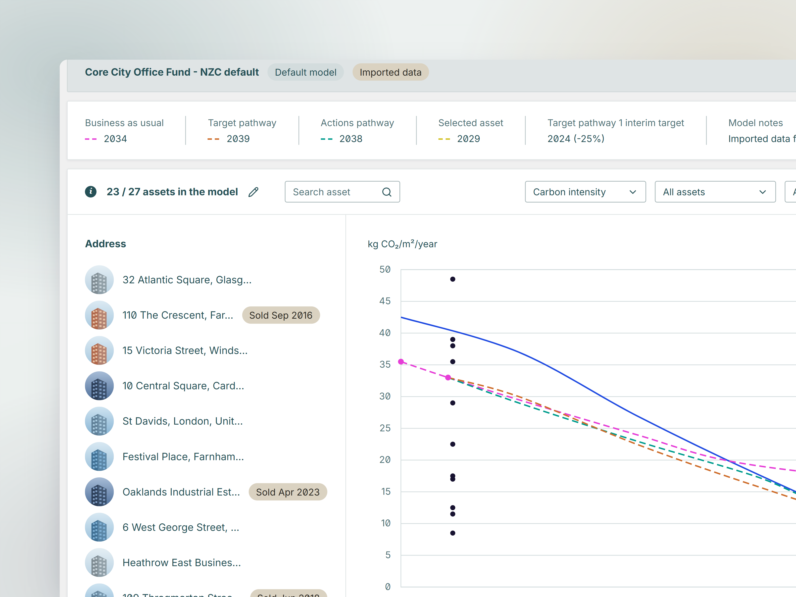

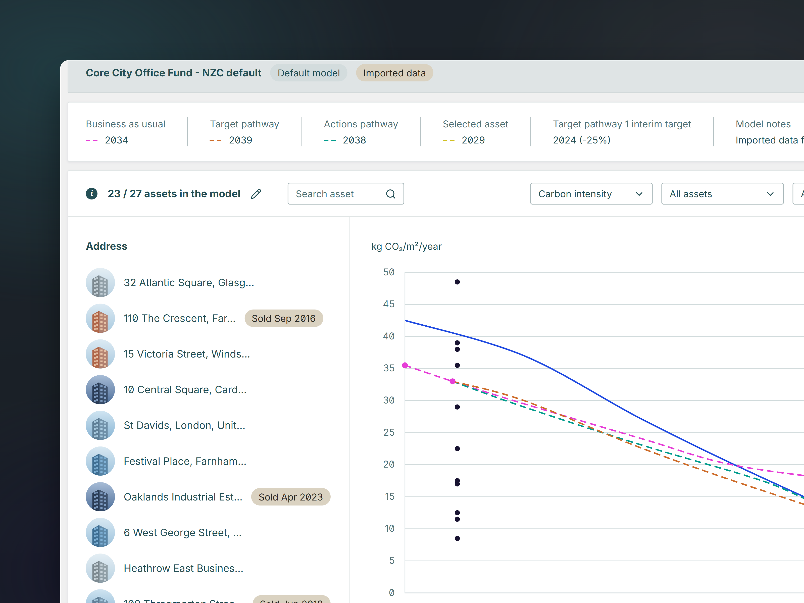

In its pathway settings, the model can switch between the 1.5°C and 2°C CRREM targets, include agreed or applicable actions, upload top-down pathways from a template and add custom target pathways.

**Give every pathway its stranding year.** A row above the chart lists the year each pathway strands, marked in the same colour and dash as its line, so business as usual, the action plan and the target pathway can be compared without working out where each line crosses the target.

## Bringing in Energy Star ratings

Clients who rate their buildings in Energy Star Portfolio Manager can bring those ratings into SIERA. Data from outside SIERA is handled with the same care as its own, so SIERA suggests a match for each asset and the match only counts once the client confirms it. Where an address could belong to more than one record, the row becomes a dropdown of the candidates, so the uncertain matches are the ones that ask for attention.

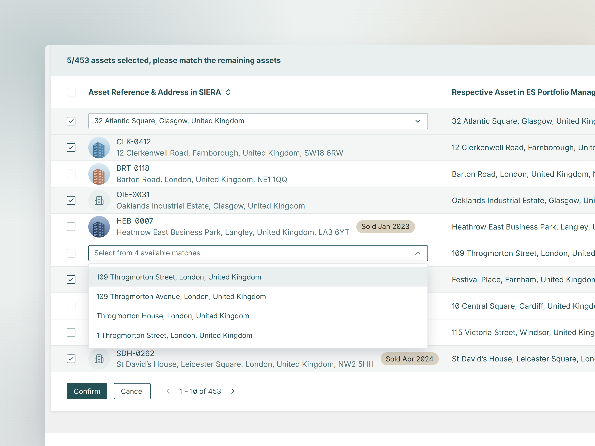

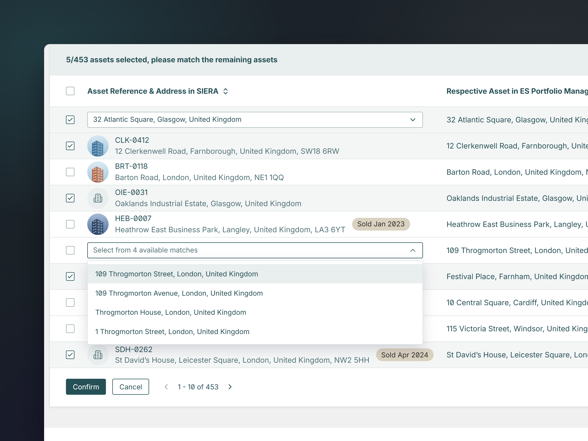

## A design system for dense data

SIERA's screens share one set of components: colours including the EPC rating scale, form fields, dropdowns with grouped checkboxes and search, tags, tooltips and small modals such as the session timeout warning.

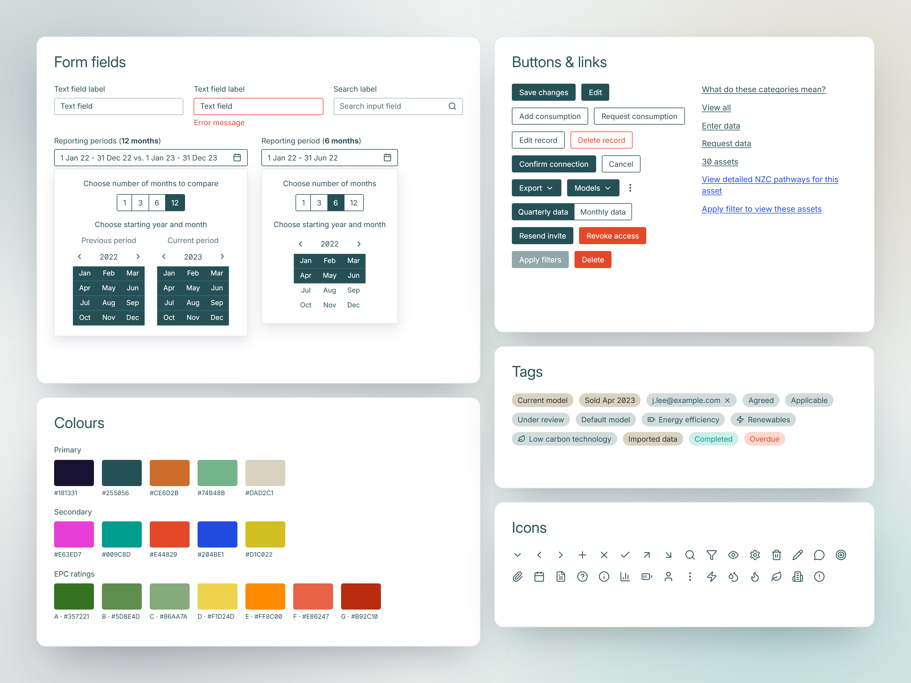

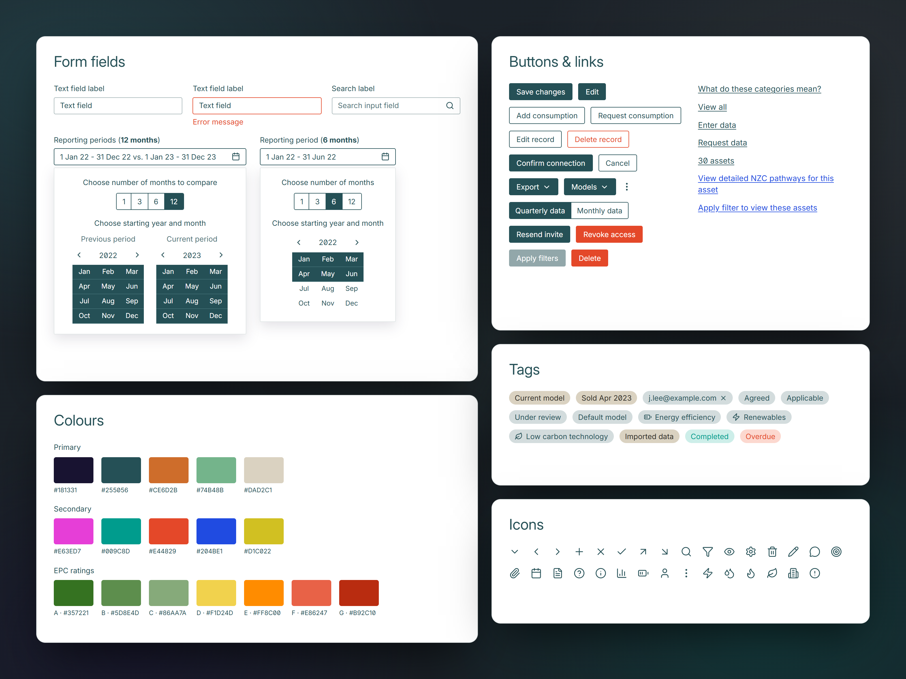

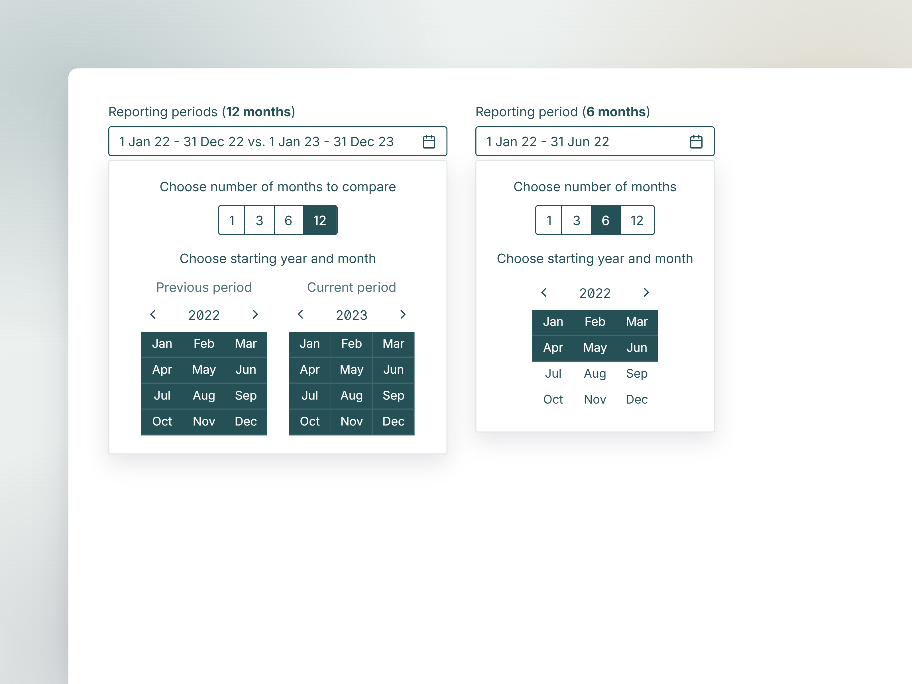

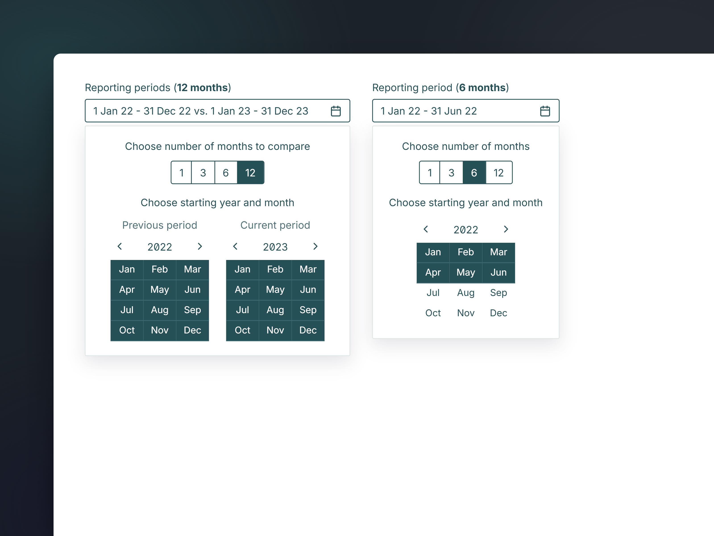

The reporting period picker is the component most specific to the domain. Funds report on different financial years and compare a period with the one before, so the picker chooses a length of 1, 3, 6 or 12 months and a starting month, and can set the previous period alongside the current one.

## Outcome

Once these versions launched, clients went past the asset list, opening their assets and going through the tabs, from the dashboard to performance, data quality and net zero.

  
<strong>46 → 203</strong>visits a month to the asset tabs, from earlier versions to the first six months after launch

## Rebranding a live product

In 2023 I also led the front-end side of Evora's rebrand in SIERA, moving every hard-coded colour into one source of truth in under three weeks. That work is written up with my other [branding](/projects/branding/) projects.

Working in a large, long-lived codebase taught me small reviewable steps and systems before screens, which shaped the [design system](/projects/design-system/) for the new platform.
