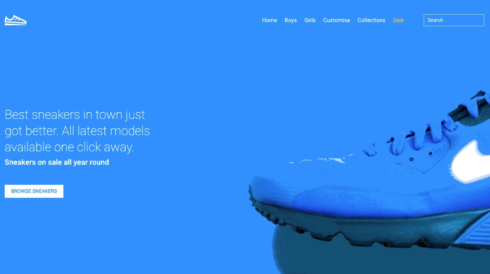
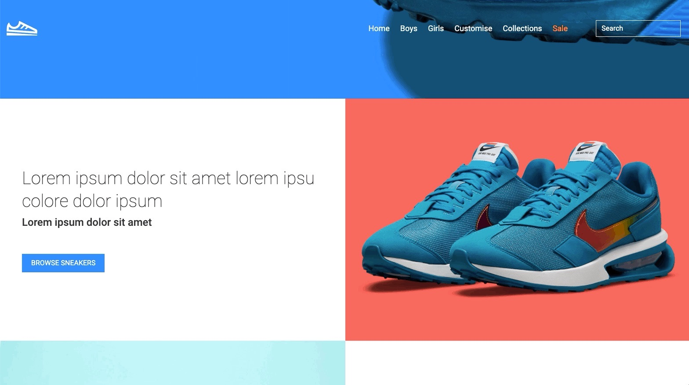
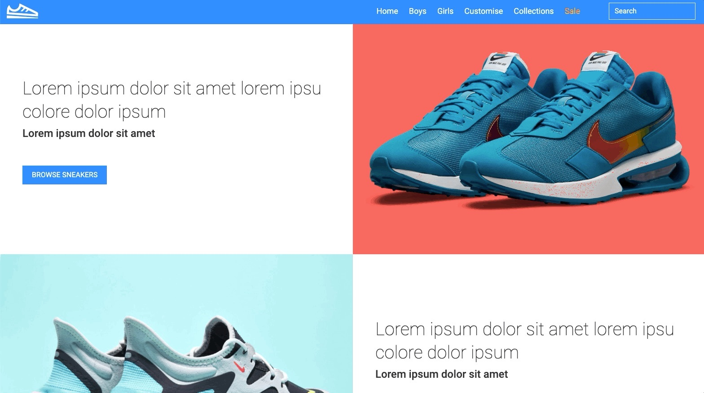
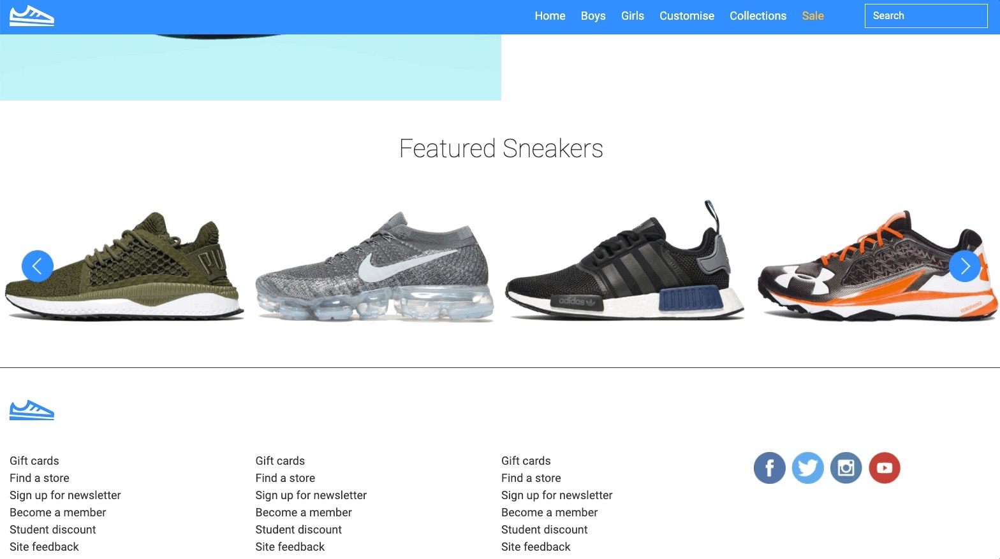

## Context

A concept landing page, built as a front-end exercise in getting the details right with nothing beyond Bootstrap.

<!-- TODO (Marius): was this a take-home test, a client pitch or a practice project? -->

- **A hero that fills exactly one screen,** recalculated on resize.
- **A scroll-aware header:** transparent over the hero, solid blue and tighter once you scroll past it.
- **Alternating product rows** that stack on a phone.

## What I'd do differently

The copy is placeholder, so this is a layout study. Next time: real content, CSS `position: sticky` with an IntersectionObserver instead of the jQuery scroll handler, and a keyboard-accessible carousel.
