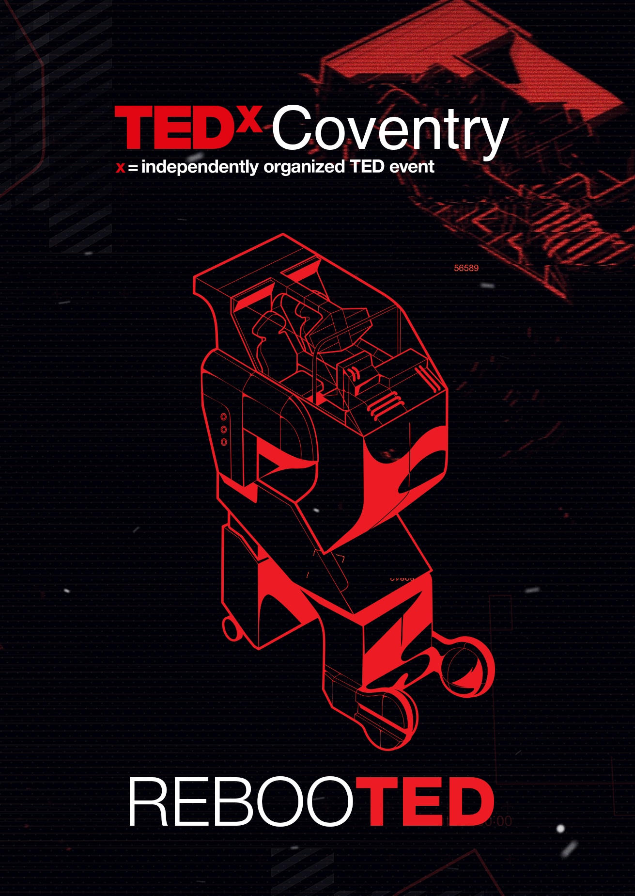
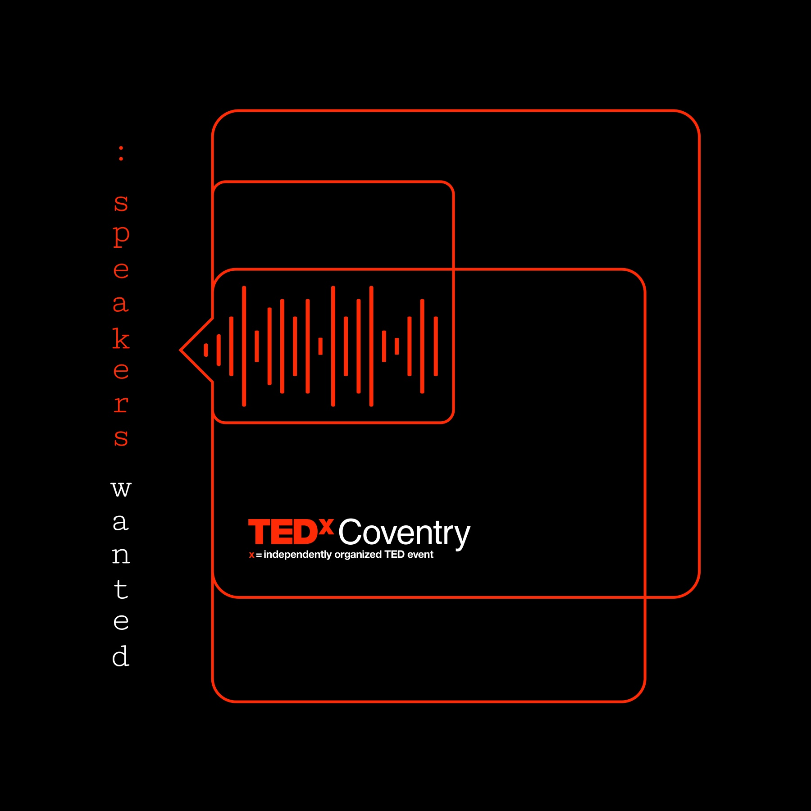
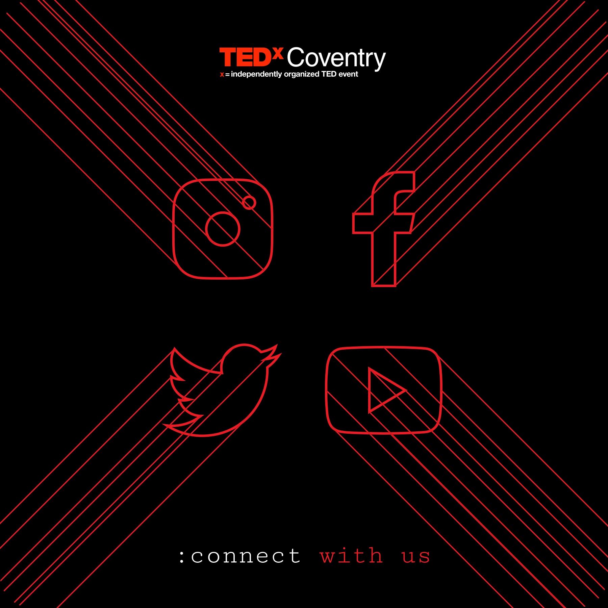
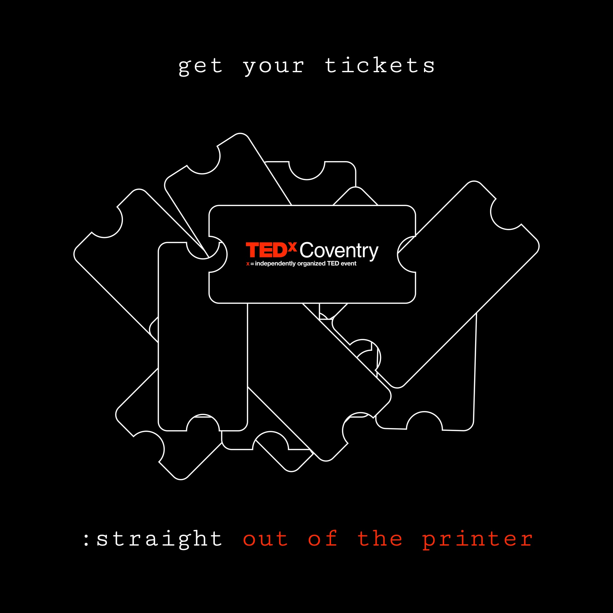
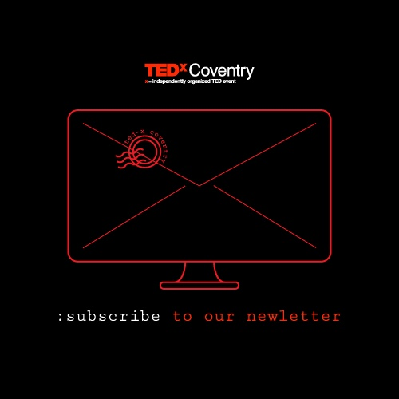
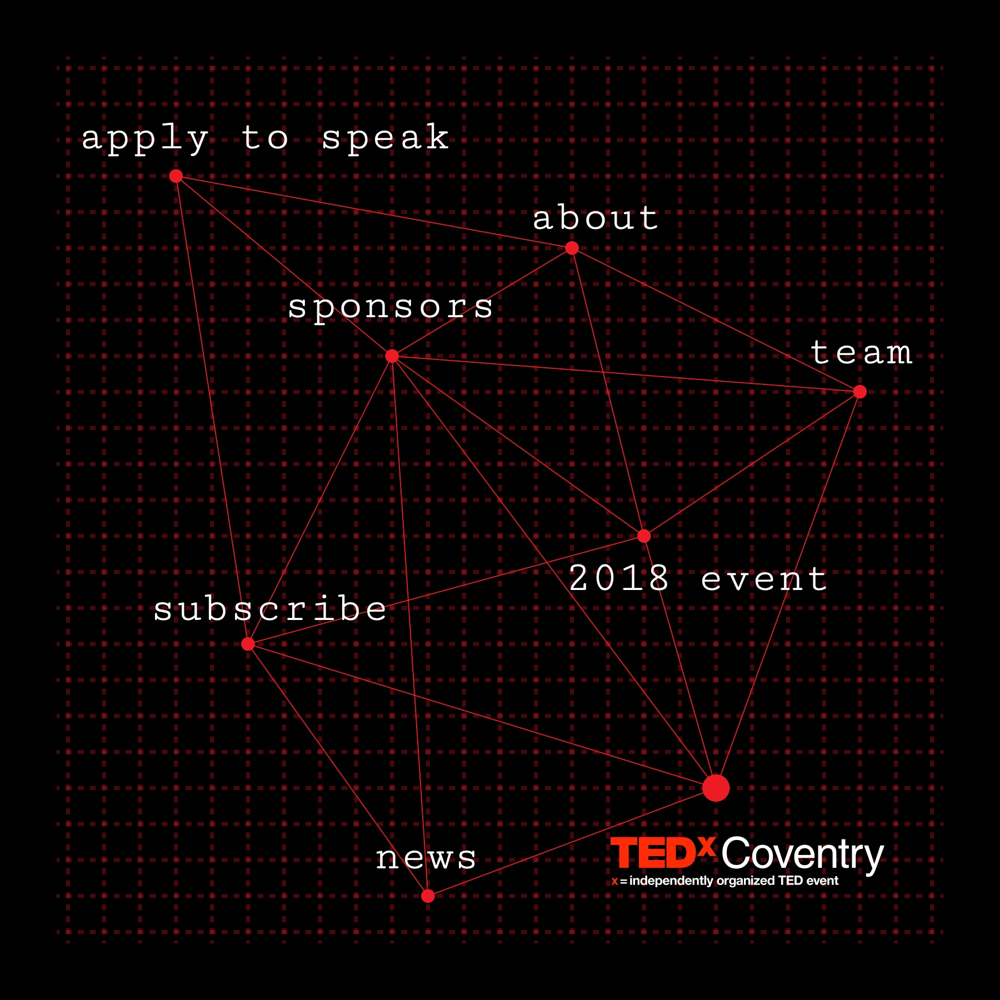
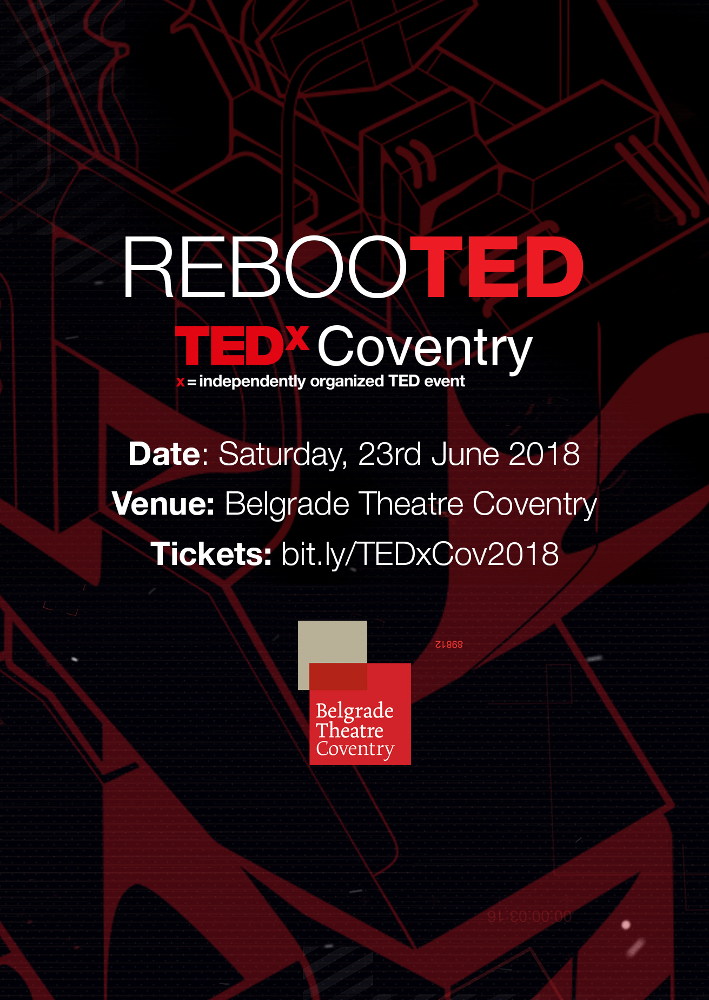
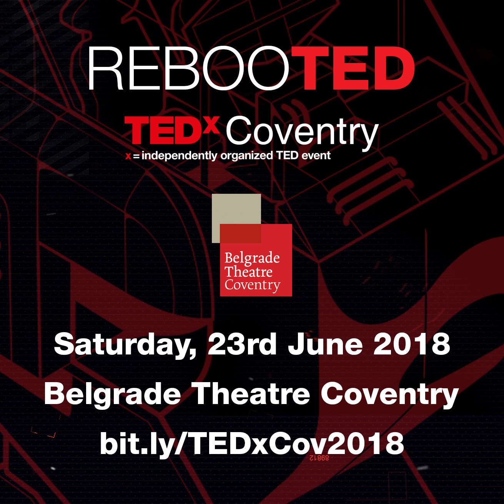
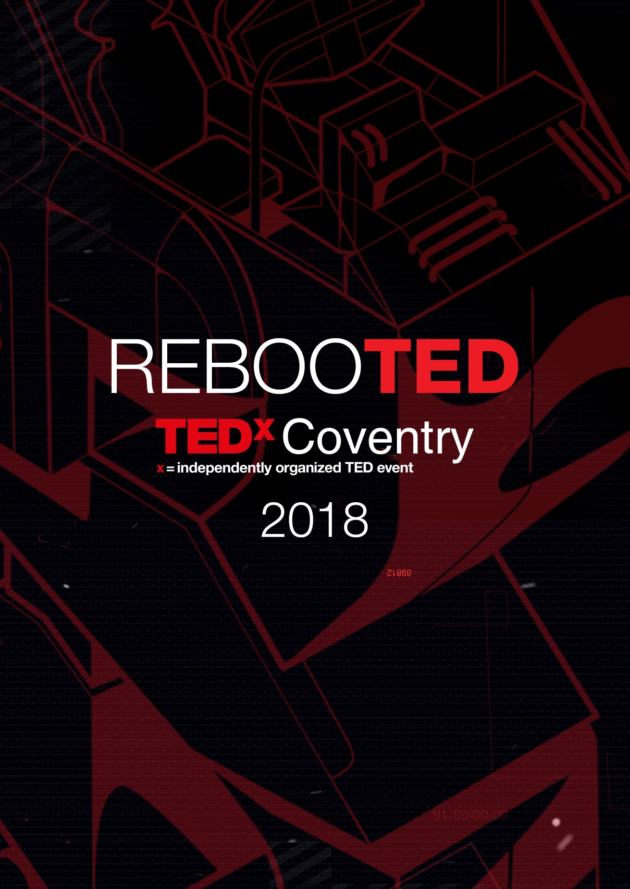

## Context

The first TEDxCoventry took place on **23 June 2018 at the Belgrade Theatre**, under the theme **REBOOTED**. In the run-up, the organisers needed social posts for very different asks (apply to speak, buy a ticket, subscribe, follow, visit the website), and every one had to be recognisably TEDxCoventry before anyone read it.

<!-- TODO (Marius): confirm your role (volunteer, team member or freelance), and whether you drew the robot illustration or adapted it. -->

## Social media graphics

A few rules kept every square post quick to make and part of one set:

- **Red and white line art on black:** the TED palette, drawn as outlines so it reads as TEDx's own.
- **One object per ask.**
- **A typewriter line** starting with a colon, partly in red.

**Line art instead of photography.** A first edition has no event photos, and stock photography makes every event look the same. Line drawings could be made for any ask, at any time.

## Date, venue and the day itself

The same look carried onto paper: the programme and the lanyards.

<!-- TODO (Marius): add photos from the event (the stage, screens or printed pieces in use), and an outcome, e.g. attendance or number of speakers. -->
